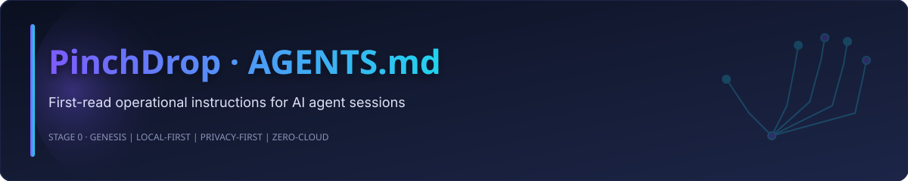

# AGENTS.md · Agent Operational Instructions

| Attribute | Specification |
|---|---|
| **Status** | 🟢 Active |
| **Owner** | Lead AI Engineer &amp; Technical Writer |
| **Last Updated** | 2026-11-24 |
| **Source of Truth For** | AI Agent operating protocols, reading order, and non-negotiables |

> [!IMPORTANT]
> **EVERY AI agent session MUST read this file first before taking any action or planning any work.**

---

## 1. Project One-Liner

**PinchDrop** is a **Windows desktop app + Android companion app** that lets you **move and organise files, links, and text between your PC and phone using hand gestures seen by the laptop webcam** — grab with a pinch, drop by opening your hand.

---

## 2. Mandatory Reading Order

When entering the codebase, read documents in this exact order:

1. [memory.md](memory.md) — Current snapshot, decisions log, gotchas, and open questions.
2. [rules.md](rules.md) — Coding standards, non-negotiables, and safety policies.
3. [task.md](task.md) — Master sprint board, active stage tasks, and acceptance criteria.
4. [product.md](product.md) — Persona definitions, MoSCoW scope, and Sharing Matrix.
5. [architecture.md](architecture.md) — Module boundaries, sequence flows, and tech stack versions.
6. [design.md](design.md) — Aurora glass design tokens, wireframes, and UI component states.

---

## 3. How to Pick and Execute the Next Task

1. Consult [task.md](task.md) to inspect the current stage.
2. Pick the highest priority uncompleted task (`⚪ Pending`) with all dependencies met.
3. Follow the **Stage Protocol**:
   - **Plan:** Outline exact files to edit and tests to execute.
   - **Implement:** Write code adhering strictly to [rules.md](rules.md).
   - **Test:** Run toolchain unit tests and replay harnesses.
   - **Update Docs:** If any behavior, threshold, or decision changed, update all corresponding Markdown documents in the same commit.
   - **Report:** Provide a concise summary of changes, quality gate verification, and next steps.

---

## 4. Absolute Non-Negotiables

- **Single Source of Truth:** Never hardcode duplicate values. Keep numbers, thresholds, and prices defined in canonical files and referenced elsewhere.
- **Never Use CDNs at Runtime:** All models (MediaPipe Tasks-Vision WASM/TFLite), fonts, and assets must be bundled locally. The application and documentation build must work 100% offline.
- **Zero-Storage Camera Privacy:** Camera frames are processed strictly in volatile memory. Never log landmark streams, never save video frames, never transmit vision data.
- **Safe File Deletions Only:** Permanent file deletion via gesture is prohibited. All deletions route strictly through the operating system Recycle Bin via the `trash` crate, backed by an 8-second visual Undo toast and persistent undo journal.
- **Allow-List File Operations:** The backend must only read, write, or modify files within explicitly user-approved directory roots. Block all path traversal (`..`) attempts.
- **Commit as You Go:** Use Conventional Commits (`docs:`, `chore:`, `feat:`, `fix:`, `test:`). Never push unless explicitly requested.

---

## 5. Developer Commands Cheat-Sheet

| Command | Purpose |
|---|---|
| `pnpm install` | Install monorepo dependencies across packages |
| `pnpm test` | Run Vitest unit tests in `@pinchdrop/gesture-core` |
| `pnpm audit:latency` | Run microsecond-precision latency and jitter benchmark |
| `pnpm audit:package` | Audit packaging manifests, installer configs, and signing rules |
| `pnpm docs:assets` | Generate SVG banners, badges, palette swatches, and glyphs |
| `pnpm docs:diagrams` | Generate Mermaid diagrams and offline SVG fallbacks |
| `pnpm docs:check` | Validate that all markdown internal file links resolve |
| `pnpm docs:pdf` | Compile offline executive PDF overview via headless browser |
| `pnpm docs:all` | Run complete documentation and asset generation pipeline |

---

## 6. Definition of Done (DoD)

A task or stage is considered complete only when:
1. All acceptance criteria specified in [task.md](task.md) are satisfied.
2. Unit tests and replay harnesses pass with zero failures.
3. No lint or type errors exist (`tsc`, `clippy`, `detekt`).
4. All impacted Markdown documents and diagrams are synchronized.
5. All internal links pass `pnpm docs:check`.
6. Self-check quality gate is confirmed and documented in the final report.

---

## 7. When Blocked, Ask

If you encounter conflicting requirements, unclear platform boundaries (e.g. OEM-specific Android battery managers), or performance regressions on target hardware, **record the issue in [memory.md](memory.md) under Open Questions**, flag it clearly to the user, and request clarification before proceeding.

---

[← Prev: README.md](README.md) · [Index](README.md) · [Next: memory.md →](memory.md)
