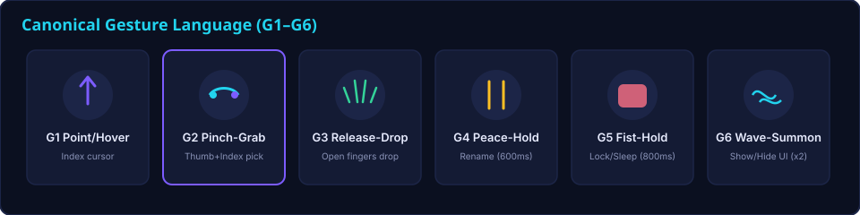

# PinchDrop


[](task.md)
[](task.md)
[](docs/security-privacy.md)
[](architecture.md)
[](LICENSE)

> [!NOTE]
> **PinchDrop** is a dedicated Windows desktop application paired with an Android companion app that lets you move and organise files, links, and text between your PC and phone using **natural hand gestures seen by your laptop webcam** — grab with a pinch, drop by opening your hand.

---

## 🟣 Product Overview

File transfer between phone and PC is already commoditised by tools like Google Quick Share for Windows, Microsoft Phone Link, and LocalSend. **Our value is the physical interaction model**: a purpose-built spatial workspace with oversized targets, forgiving gestures, safe undoable operations, and a phone Stage Tray. It feels like moving physical objects across your desk.

- **Local-first & Private:** Zero cloud servers, no user accounts required. Camera frames are processed strictly in volatile GPU memory and never recorded or transmitted.
- **Tagline (working):** *"Move things with your hands."*
- **The Core Grab → Catch Model:** The webcam sees your hands and your PC screen. By bridging via a one-tap phone Share Sheet (or Quick Settings tile), you trigger **Quick Catch (30 s)** on the PC, pinch anywhere in mid-air to grab the item's floating card, and drop it directly onto any folder or action zone.


---

## ✋ How It Works (The Core Interaction)

### 1. Grab on Phone (One Tap)
In Google Photos, Files, Chrome, or any Android app, tap **Share → PinchDrop** (or tap the Quick Settings tile *"Grab latest photo"*). The phone immediately holds the item and sends a lightweight thumbnail and metadata over local Wi-Fi.

### 2. Armed on PC (Automatic)
The paired Windows PC instantly displays a floating pointer chip (e.g. `📷 1 Photo Ready`) and enters the **ARMED state for 30 seconds**.

### 3. Catch in Mid-Air (Gesture)
**Pinch anywhere** in front of your laptop webcam. The item's thumbnail snaps to your hand cursor in the spatial workspace.

### 4. Drop on Zone or Folder
Move your hand over any folder, the PC desktop, or an edge zone (e.g. *Open in Browser*, *Copy to Clipboard*, or *Send to Phone*) and **open your hand**. The file streams directly over encrypted local LAN and settles in place with an **8-second visual Undo toast**.


---

## 📋 Canonical Sharing Matrix

| Content | 📱→💻 Grab Source (Phone) | 📱→💻 Land Target (PC) | 💻→📱 Pinch Source (PC) | 💻→📱 Land Target (Phone) |
|---|---|---|---|---|
| **Photos** | Share → PinchDrop (Google Photos etc.) · tile "Grab latest photo" · Peek | Folder · Open in default app · PC clipboard (paste anywhere) · Inbox (Throw) | Image files | Gallery (MediaStore Pictures) |
| **Videos / movies** | Share → PinchDrop · Peek | Folder · Open · Inbox | Video files (multi-GB OK) | Movies folder (MediaStore) |
| **Screenshots** | Tile "Grab latest screenshot" · Share | Folder · PC clipboard | Region/screen capture card (v1.1) | Gallery |
| **Documents, PDFs, any file** | Share → PinchDrop (from Files, Drive, WhatsApp…) | Folder · Open · Inbox | Any file | Downloads (MediaStore/SAF) · **Open on phone** zone launches it |
| **Folders** | Pick folder in app (v1.1) | Folder | Folder (sent as a stream/zip) | Downloads/PinchDrop |
| **Links / URLs** | Share → PinchDrop (from Chrome, YouTube, Maps…) | **Open in PC browser** zone · Clipboard · Notes file | Link card (from clipboard/browser extension, v1.1) | **Open on phone** zone (opens in phone browser) |
| **Text / notes / snippets** | Share → PinchDrop · tile "Grab clipboard" | Clipboard · `.txt` in folder | Text card / selection | Phone clipboard · note file |
| **Scanned document** | In-app ML Kit scanner → PDF straight to PC | Folder · Open | — | — |
| **Camera capture / voice memo** | In-app capture straight to PC tray | Folder · Open | — | — |
| **Many items at once** | Multi-select share (`ACTION_SEND_MULTIPLE`) | Two-hand pinch = take all | Lasso (two-hand, v1.1) | Same zones |

---

## ✋ Canonical Gesture Language (G1–G6)



| ID | Gesture | Hand Pose | Meaning | Safety Guard |
|---|---|---|---|---|
| **G1** | **Point / Hover** | Open hand, index leading | Moves smoothed cursor over cards | Active only in interaction box (central 65% of camera frame) |
| **G2** | **Pinch-Grab** | Thumb tip(4)–Index tip(8) close | Picks up item or catches ARMED item | Scale-invariant ratio `≤ 0.30` + 120 ms dwell |
| **G3** | **Release-Drop** | Fingers open | Drops item into folder or zone | Debounce; exit ratio `≥ 0.45` |
| **G3b** | **Throw (Flick)** | Pinch-hold, flick toward edge | Instantly sends to default Phone/Inbox | Velocity `≥ 0.6` screen-widths/s + 8s Undo Toast |
| **G4** | **Peace-Hold** | Index + Middle extended (600ms) | Triggers Rename virtual keyboard | Radial countdown ring; cancel by dropping hand |
| **G5** | **Fist-Hold (Lock)**| Closed fist held for 800ms | Puts tracking to sleep (0% camera CPU) | Distinct from pinch; repeat 800ms to wake |
| **G6** | **Wave-Summon** | Open palm side-to-side (2x in 1s) | Shows or hides the Air Workspace | Frequency filter prevents false triggers |

---

## 🛠️ Architecture & Technology Stack


| Layer | Technology | Role & Purpose |
|---|---|---|
| **Desktop Shell** | **Tauri 2 (Rust)** | Lightweight native Windows container (<60 MB installer, native WebView2 host). |
| **Desktop UI** | **React 18 + TypeScript + Vite** | Fluid 60 fps aurora glass UI with **Tailwind CSS**, **Framer Motion**, and **Zustand**. |
| **Computer Vision** | **@mediapipe/tasks-vision** | In-memory HandLandmarker (GPU delegate, VIDEO mode, locally vendored, zero CDN). |
| **Gesture Core** | **Pure TypeScript Package** | Deterministic One-Euro filter, landmark classifiers, and XState state machine. |
| **Rust Systems Core** | **Tokio, Axum, Rustls** | Local TLS 1.3 server, mDNS discovery, and high-performance chunked file streaming. |
| **File Safety** | **`trash` crate + Allow-List** | Deletions route strictly to OS Recycle Bin; allow-list prevents path traversal. |
| **Cryptographic Hash**| **BLAKE3** | Multi-threaded cryptographic chunk hashing for resumable transfers. |
| **Android App** | **Kotlin + Jetpack Compose** | Material 3 mobile companion, Share Target, Quick Settings tiles, and WorkManager. |

---

## 🎨 Design System: Aurora Glass


PinchDrop is styled in a futuristic, calm, dark-first **aurora glass** theme:
- Deep space background (`--bg: #0B1020`) with semi-transparent frosted cards (`--surface: #141B34`).
- Vibrant aurora accents: Purple (`--primary: #7C5CFF`) and Cyan (`--accent: #22D3EE`).
- Large, forgiving targets: minimum interactive target dimension is **96 px** with magnetic attraction within 48 px.

---

## 🔒 Security & Privacy Guarantees

1. **Zero Camera Recording:** Video frames are processed strictly in volatile GPU memory and immediately discarded. No video, images, or landmark coordinates are ever written to disk or sent across the network.
2. **Peer-to-Peer Encryption:** PC and phone pair via mutual QR code scanning, pinning self-signed Ed25519 certificates over local **TLS 1.3**.
3. **Safe File Operations:** Permanent file deletion via gesture is prohibited. All deletions route through the Windows Recycle Bin backed by an **8-second visual Undo toast** and persistent undo journal.
4. **Allow-List Protection:** The app only touches directories explicitly approved by the user, blocking path traversal (`..`) attempts.

---

## 🚀 Development Roadmap (S0–S13)

| Stage | Focus Area | Status | Progress |
|---|---|---|---|
| **S0** | **Genesis (Repo, Docs, Asset Pipeline, PDF)** | 🟢 Done | `▰▰▰▰▰▰▰▰▰▰ 100%` |
| **S1** | **Gesture Lab (MediaPipe + One-Euro + HUD)** | 🟢 Done | `▰▰▰▰▰▰▰▰▰▰ 100%` |
| **S2** | **Gesture Core (Deterministic FSM + Replay)** | ⚪ Pending | `▱▱▱▱▱▱▱▱▱▱ 0%` |
| **S3** | **Air Workspace UI (Tauri 2 + React + Cards)** | ⚪ Pending | `▱▱▱▱▱▱▱▱▱▱ 0%` |
| **S4** | **File Ops & Safety Engine (Rust + Trash + Undo)** | ⚪ Pending | `▱▱▱▱▱▱▱▱▱▱ 0%` |
| **S5** | **LAN Server & Pairing (TLS 1.3 + mDNS)** | ⚪ Pending | `▱▱▱▱▱▱▱▱▱▱ 0%` |
| **S6** | **Android App v0 (Compose + MediaStore)** | ⚪ Pending | `▱▱▱▱▱▱▱▱▱▱ 0%` |
| **S7** | **Grab → Catch & Stage Tray (End-to-End)** | ⚪ Pending | `▱▱▱▱▱▱▱▱▱▱ 0%` |
| **S8–S13** | **Clipboard, Gym, Polish, Store Packaging, Launch** | ⚪ Pending | `▱▱▱▱▱▱▱▱▱▱ 0%` |

---

## 🧭 Repository Documentation Index

| Document | Primary Focus & Ownership |
|---|---|
| [AGENTS.md](AGENTS.md) | **Must-read first** for AI agent sessions; stage protocol and operational rules. |
| [memory.md](memory.md) | Persistent memory, single source of truth registry, glossary, and decision history. |
| [product.md](product.md) | Product vision, personas (P1–P5), competitive landscape, and canonical Sharing Matrix. |
| [architecture.md](architecture.md) | Component architecture, sequence flows, data models, and version-pinned dependencies. |
| [rules.md](rules.md) | Non-negotiables, strict safety rules, coding conventions, and testing policies. |
| [task.md](task.md) | Master roadmap (S0–S13), live task tracking, Gantt chart, and backlog. |
| [design.md](design.md) | Aurora glass design tokens, wireframes, gesture feedback matrix, and component catalog. |
| [docs/gestures.md](docs/gestures.md) | Full 6-pose gesture specification, One-Euro tuning, and Sharing Cheat Sheet. |
| [docs/protocol.md](docs/protocol.md) | WebSocket protocol envelopes, HTTP Range chunking, and resume algorithms. |
| [docs/security-privacy.md](docs/security-privacy.md) | Threat model, zero-storage camera privacy guarantee, and mutual TLS pairing. |
| [docs/monetization.md](docs/monetization.md) | Free core tier, Pro feature hypotheses, unit economics, and launch plan. |
| [docs/services.md](docs/services.md) | Guide to external credentials, Windows code signing, Play Store, and secrets. |
| [docs/PinchDrop_Overview.pdf](docs/PinchDrop_Overview.pdf) | Offline-generated comprehensive PDF executive overview. |

---

## ⚡ Developer Quick-Start

```bash
# Verify workspace dependencies and link packages
pnpm install

# Run gesture-core unit and smoke tests
pnpm test

# Generate offline documentation assets and diagrams
pnpm docs:assets
pnpm docs:diagrams

# Check all documentation internal links
pnpm docs:check

# Compile executive PDF overview (requires local Chrome or Edge)
pnpm docs:pdf
```

---

[Index](README.md) · [Next: AGENTS.md →](AGENTS.md)
