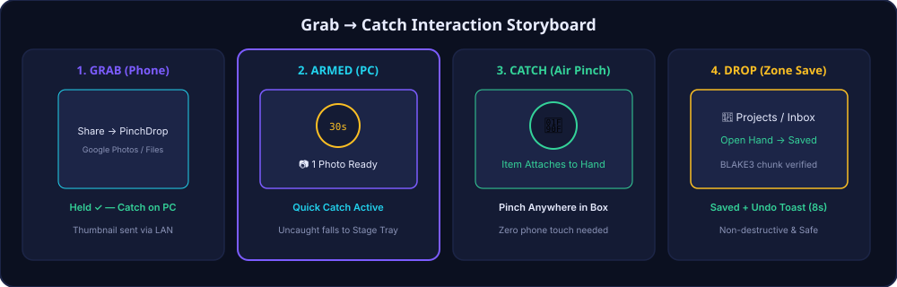

# PinchDrop


[](task.md)
[](task.md)
[](docs/security-privacy.md)
[](architecture.md)
[](LICENSE)

> [!NOTE]
> **PinchDrop** is a Windows desktop app plus an Android companion app. It lets you move files, folders, links and text between your PC and phone with **your hands, seen by the laptop webcam**. Select something, **pinch** to grab it, carry it, and **open your hand over your phone** to drop it there.

**Where we are (2026-11-25):** v1 works end to end on real hardware (HP laptop + POCO F7). v1.1 (the founder's polish list) is done. **Next up is v2:** phone → PC with gestures, notifications, SMS, calls answered with your hand, fast big-file transfer, several devices. See [the v2 plan](docs/v2-plan.md).

---

## ✋ How it works today (v1 / v1.1)

### On the PC
1. **The pill.** A small black pill sits at the top of the screen (always on top, even over full-screen apps). It shows your phone's name and live battery.
2. **The Dynamic Island.** Click the pill, or press **Ctrl + Shift + Space**, and it morphs into the Island. From there you can:
   - start the camera, either automatically or with a **Start gestures** button (you choose in Settings)
   - send files
   - pause gestures
   - open the app
3. **Pinch to grab.** Select files or a folder in Explorer or on the desktop, then pinch in front of the webcam.
   - A small preview card (about the size of a desktop icon) sticks to your fingers: the real thumbnail for photos, videos, PDFs and Office files; a folder with its contents; the first lines of a text file; a link card.
   - With nothing selected, a pinch takes what's on your **clipboard** instead:
     - a **link** opens on the phone when it arrives
     - **short text** goes to the phone's clipboard
     - **long text** becomes a `.txt` file with the exact formatting
     - **formatted text** becomes an `.html` file
4. **Open your hand** to put it "in the air". The Island counts down (30 s) while the phone gets ready to catch it.
5. **Or just drop files on the app window** (or use Send files…). A lift-off animation shows the item flying up, then the Island takes over with live progress, %, speed and Cancel.

### On the phone
1. When the PC holds something, the phone **opens its Catch camera by itself**, over the lock screen too, like a call. This needs one permission: **Open PinchDrop by itself**.
2. **Open your hand over the phone.** It catches the item and the transfer starts.
3. A **bottom sheet** slides up with live progress, then turns into a **green tick** when it has landed. Photos go to the Gallery, everything else to `Downloads/PinchDrop`, and links open by themselves.
4. If the app is closed, a notification shows the progress instead.



---

## 📋 What you can send (v1)

| Content | From the PC | Lands on the phone |
|---|---|---|
| Photos | Pinch or drop | Gallery (Pictures/PinchDrop) |
| Videos, multi-GB movies | Pinch or drop | Gallery (Movies/PinchDrop) |
| Documents, PDFs, any file | Pinch or drop | Downloads/PinchDrop |
| Folders (with subfolders) | Pinch or drop | Downloads/PinchDrop/&lt;folder&gt; |
| Links copied in a browser | Pinch with nothing selected | Opens in the phone's browser |
| Short text | Pinch with nothing selected / Send text | Phone clipboard |
| Long text (Notepad etc.) | Pinch with nothing selected | `.txt` file, exact text and line breaks |
| Formatted text (Word, web) | Pinch with nothing selected | `.html` file, keeps bold, lists and links |

Sends are **copy** by default. **Move** sends the PC copy to the Recycle Bin only after the phone confirms it has everything. Interrupted transfers resume.

---

## ✋ Gestures

| | Gesture | Meaning |
|---|---|---|
| **v1** | **Pinch** (thumb + index) | Grab the Explorer selection or the clipboard |
| **v1** | **Carry** | Move the card; it follows your fingers smoothly at screen refresh rate |
| **v1** | **Open hand** (PC) | Put it in the air for the phone |
| **v1** | **Open hand** (phone) | Catch it |
| **v2** | Palm hold · Swipe · ✌️ hold · 👍 · Fist hold · Throw · Point & dwell · Wave · Two-hand frame · Pinch at phone · Hover over phone | Answer/reject calls, reply, confirm, silence, pick a device, open the Island, screenshot, phone → PC — see the [v2 gesture set](docs/v2-plan.md#2-the-v2-gesture-set) |

Gestures are strict on purpose. A pinch only counts when your hand is close enough, steady, and tracked confidently, so nothing happens by accident. The camera only runs while the Island is open, and switches off after 30 s with nothing happening.

---

## 🚀 Version 2: what's next

Full details of how each one works: **[docs/v2-plan.md](docs/v2-plan.md)**.

1. **Phone → PC with gestures:** Share → PinchDrop on the phone, pinch at the phone, open your hand at the laptop; it lands and opens on the PC.
2. **Phone notifications on the Island:** swipe to dismiss, ✌️ to reply.
3. **SMS:** read and reply from the PC.
4. **Contacts** on the PC.
5. **Calls:** the caller shows on the Island; **open palm = answer**, **swipe = reject**, **fist = silence**.
6. **Fast mode for big files:** parallel streams, no re-compression, Wi-Fi Direct.
7. **Proximity catch:** hover over the phone to catch, no camera needed.
8. **Several phones and tablets:** device chips fan out while you carry; point, throw or open your hand over the device you want.
9. **Laptop ↔ laptop:** catch with the other laptop's webcam.
10. **New gestures** for all of the above.
11. *Proposed:* clipboard both ways · two-hand-frame screenshot · find my phone.

---

## 🛠️ Technology

| Layer | Technology | Role |
|---|---|---|
| Desktop shell | **Tauri 2 (Rust)** | Pill, Island, overlay and main windows; ~12 MB installer; WebView2 |
| Desktop UI | **React + TypeScript + Vite**, Tailwind, Framer Motion | Apple-style white UI, jet-black Island, spring animations |
| Hand tracking (PC) | **MediaPipe Tasks Vision** (bundled, no CDN) | Hand landmarks from the webcam, in memory only |
| Gesture logic | **`@pinchdrop/gesture-core`** (TypeScript) | One-Euro filter, strict grab state machine, unit-tested |
| Windows integration | `windows` crate (Shell COM, GDI) | Explorer/desktop selection, shell thumbnails, clipboard, global shortcut |
| Link | **LINK-v1**: WebSocket over TLS (rustls), mDNS discovery | Pinned self-signed certificate, QR or 6-digit pairing, chunked resumable transfers |
| Android app | **Kotlin + Jetpack Compose**, CameraX, MediaPipe, DataStore | Catch camera, receive sheet, MediaStore saving, foreground link service |

Protocol: [packages/protocol/LINK-v1.md](packages/protocol/LINK-v1.md) · Architecture: [architecture.md](architecture.md)

---

## 🎨 Look

A fresh white, Apple-style design on both apps: soft grey background (`#F5F5F7` / `#F2F2F7`), white cards, one confident blue (`#0071E3` / `#007AFF`). The pill and Island are **jet black** so they read on any wallpaper. A dark (graphite / true-black) theme is optional.

---

## 🔒 Privacy & safety

1. **Camera frames are never stored or sent.** They go straight from the webcam into hand tracking in memory and are dropped. The camera runs only while you've asked for it.
2. **Local only.** No cloud, no accounts. PC and phone talk directly over your Wi-Fi, encrypted with a certificate pinned at pairing.
3. **No permanent deletes.** "Move" uses the Recycle Bin, and only after the phone confirms.
4. **Only what you pick.** The app only reads what you selected or dropped.

---

## 🗺️ Roadmap

| Phase | What | Status |
|---|---|---|
| **P1** | Desktop shell: pill, Dynamic Island, main window, tray, settings | 🟢 Working |
| **P2** | Android app shell | 🟢 Working |
| **P3** | Pairing + encrypted link, live phone name and battery | 🟢 Working on POCO F7 |
| **P4** | Manual send: files, folders, text; resume; history | 🟢 Working |
| **P5** | Grab on PC: Explorer selection + webcam pinch | 🟢 Working |
| **P6** | Catch on phone: open-hand camera catch | 🟢 Working |
| **v1.1** | Founder polish: white look, Island, previews, smooth drag, clipboard links/notes, receive sheet | 🟢 Done (founder re-check open) |
| **P7** | Release packaging: signed installer, release APK | 🟡 Installer builds; signing pending |
| **v2** | See [docs/v2-plan.md](docs/v2-plan.md) | ⚪ Next |

Live checklist: [task.md](task.md).

---

## 🧭 Documentation

| Document | What's in it |
|---|---|
| [AGENTS.md](AGENTS.md) | Must-read first for AI agent sessions |
| [memory.md](memory.md) | Decisions log, gotchas, open questions |
| [task.md](task.md) | Phase checklists, v1.1 list, v2 backlog |
| [docs/v2-plan.md](docs/v2-plan.md) | **Version 2 features, how they work, new gestures** |
| [product.md](product.md) | Personas, scope, sharing matrix |
| [architecture.md](architecture.md) | Modules, flows, stack |
| [rules.md](rules.md) | Non-negotiables and coding rules |
| [design.md](design.md) | Design tokens and components |
| [docs/gestures.md](docs/gestures.md) | Gesture specification |
| [packages/protocol/LINK-v1.md](packages/protocol/LINK-v1.md) | PC ↔ phone protocol |
| [docs/security-privacy.md](docs/security-privacy.md) | Threat model and privacy guarantees |

---

## ⚡ Developer quick-start

```bash
pnpm install                 # workspace dependencies
pnpm test                    # gesture-core unit tests
cd apps/desktop && pnpm tauri dev      # run the desktop app
cd apps/desktop && pnpm tauri build    # Windows installer (src-tauri/target/release/bundle/nsis)
cd apps/android && ./gradlew assembleDebug   # phone APK (needs local.properties with sdk.dir)
pnpm docs:check              # check documentation links
```

---

[Index](README.md) · [Next: AGENTS.md →](AGENTS.md)
