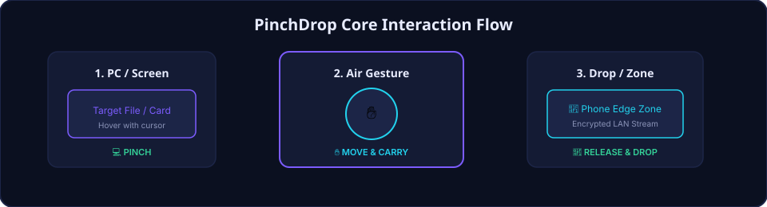
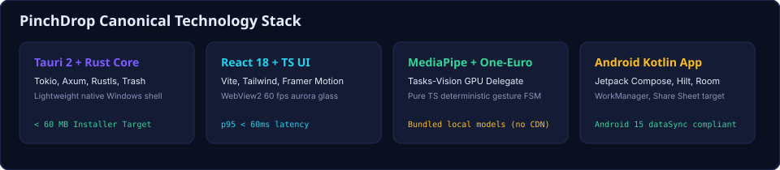

# PinchDrop


[](task.md)
[](task.md)
[](docs/security-privacy.md)
[](architecture.md)
[](LICENSE)

> [!NOTE]
> **PinchDrop** is a dedicated Windows desktop application paired with an Android companion app that lets you move and organise files, links, and text between your PC and phone using **natural hand gestures seen by your laptop webcam** — grab with a pinch, drop by opening your hand.

---

## 🟣 Product Overview

File transfer between phone and PC is already commoditised (Google Quick Share for Windows, Microsoft Phone Link, LocalSend). **Our value is the interaction model**: a purpose-built spatial workspace with oversized targets, forgiving gestures, safe undoable operations, and a phone Stage Tray. It feels like moving physical objects across your desk.

- **Local-first & Private:** Zero cloud servers, no user accounts required. Camera frames are processed strictly in volatile memory and never recorded or transmitted.
- **Tagline (working):** *"Move things with your hands."*
- **The Core Grab → Catch Model:** The webcam sees your hands and your PC screen. By bridging via a one-tap phone Share Sheet (or Quick Settings tile), you trigger **Quick Catch (30 s)** on the PC, pinch anywhere in mid-air to grab the item's floating card, and drop it directly onto any folder or action zone.



---

## 🚀 Stage Progress

| Stage | Focus Area | Status | Progress |
|---|---|---|---|
| **S0** | **Genesis (Repo, Docs, Asset Pipeline, PDF)** | 🟢 Done | `▰▰▰▰▰▰▰▰▰▰ 100%` |
| **S1** | **Gesture Lab (MediaPipe + One-Euro + HUD)** | ⚪ Pending | `▱▱▱▱▱▱▱▱▱▱ 0%` |
| **S2** | **Gesture Core (Deterministic FSM + Replay)** | ⚪ Pending | `▱▱▱▱▱▱▱▱▱▱ 0%` |
| **S3** | **Air Workspace UI (Tauri 2 + React + Cards)** | ⚪ Pending | `▱▱▱▱▱▱▱▱▱▱ 0%` |
| **S4** | **File Ops & Safety Engine (Rust + Trash + Undo)** | ⚪ Pending | `▱▱▱▱▱▱▱▱▱▱ 0%` |
| **S5** | **LAN Server & Pairing (TLS 1.3 + mDNS)** | ⚪ Pending | `▱▱▱▱▱▱▱▱▱▱ 0%` |
| **S6** | **Android App v0 (Compose + MediaStore)** | ⚪ Pending | `▱▱▱▱▱▱▱▱▱▱ 0%` |
| **S7** | **Grab → Catch & Stage Tray (End-to-End)** | ⚪ Pending | `▱▱▱▱▱▱▱▱▱▱ 0%` |
| **S8–S13** | **Clipboard, Gym, Polish, Store Packaging, Launch** | ⚪ Pending | `▱▱▱▱▱▱▱▱▱▱ 0%` |

---

## 🛠️ Technology Stack



- **Desktop Shell:** Tauri 2 (Rust) + WebView2
- **Desktop UI:** React 18, TypeScript, Vite, Tailwind CSS, Motion (Framer Motion), Zustand, XState
- **Computer Vision:** `@mediapipe/tasks-vision` HandLandmarker (GPU delegate, VIDEO mode, locally vendored)
- **Gesture Core:** Pure deterministic TypeScript package (`@pinchdrop/gesture-core`), One-Euro smoothing filter
- **Rust Core:** `tokio`, `axum`, `rustls`, `tokio-tungstenite`, `mdns-sd`, `trash`, `blake3`, `rusqlite`
- **Android App:** Kotlin, Jetpack Compose (Material 3), Coroutines/Flow, Hilt, Room, DataStore, Ktor Client (OkHttp engine), WorkManager

---

## 🚫 What PinchDrop is NOT

- **NOT a generic webcam mouse emulator:** We do not attempt fine-grained 1-pixel Windows desktop cursor control. Small Explorer targets cause extreme hand strain. We provide a tailored spatial workspace with 96+ px interactive targets.
- **NOT a cloud storage service:** No servers, no accounts, no subscriptions required for file transfer. Transfers run strictly over peer-to-peer encrypted local Wi-Fi.
- **NOT an AI camera spy:** Hand landmarks are extracted in memory. Raw video frames are discarded instantly and never touch a hard drive or network interface.

---

## 🧭 Repository Map & Documentation Index

| Document | Primary Focus & Ownership |
|---|---|
| [AGENTS.md](AGENTS.md) | **Must-read first** for AI agent sessions; stage protocol and operational rules. |
| [memory.md](memory.md) | Persistent memory, single source of truth registry, glossary, and decision history. |
| [product.md](product.md) | Product vision, personas (P1–P5), competitive landscape, and canonical Sharing Matrix. |
| [architecture.md](architecture.md) | Component architecture, sequence flows, data models, and version-pinned dependencies. |
| [rules.md](rules.md) | Non-negotiables, strict safety rules, coding conventions, and testing policies. |
| [task.md](task.md) | Master roadmap (S0–S13), live task tracking, Gantt chart, and backlog. |
| [design.md](design.md) | Aurora glass design tokens, wireframes, gesture feedback matrix, and component catalog. |
| [docs/gestures.md](docs/gestures.md) | Full 6-pose gesture specification, One-Euro tuning, and Sharing Cheat Sheet. |
| [docs/protocol.md](docs/protocol.md) | WebSocket protocol envelopes, HTTP Range chunking, and resume algorithms. |
| [docs/security-privacy.md](docs/security-privacy.md) | Threat model, zero-storage camera privacy guarantee, and mutual TLS pairing. |
| [docs/monetization.md](docs/monetization.md) | Free core tier, Pro feature hypotheses, unit economics, and launch plan. |
| [docs/PinchDrop_Overview.pdf](docs/PinchDrop_Overview.pdf) | Offline-generated comprehensive PDF executive overview. |

---

## ⚡ Quick-Start (Stage 0 Workspace)

```bash
# Verify workspace dependencies and link packages
pnpm install

# Run gesture-core smoke test
pnpm test

# Generate offline documentation assets and diagrams
pnpm docs:assets
pnpm docs:diagrams

# Check all documentation internal links
pnpm docs:check

# Compile executive PDF overview (requires local Chrome or Edge)
pnpm docs:pdf
```

---

[Index](README.md) · [Next: AGENTS.md →](AGENTS.md)
