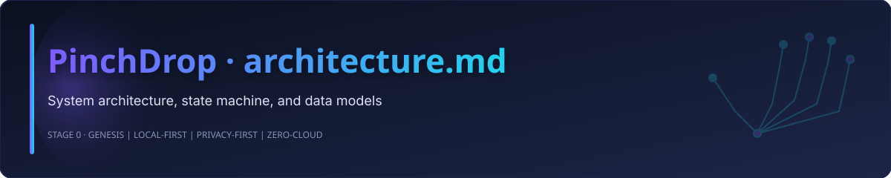
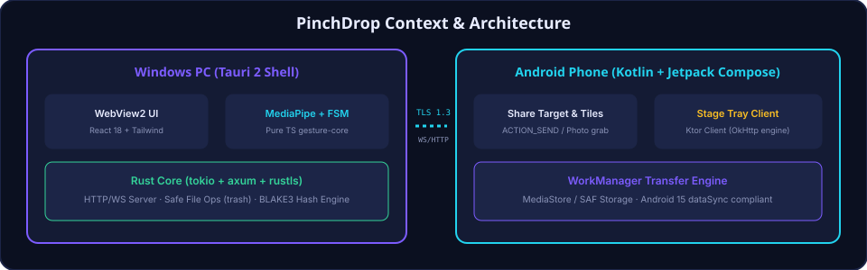
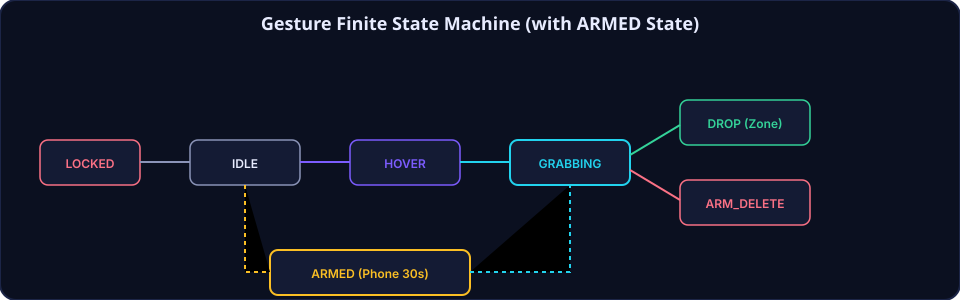
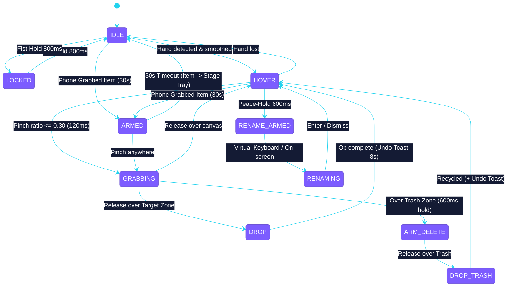
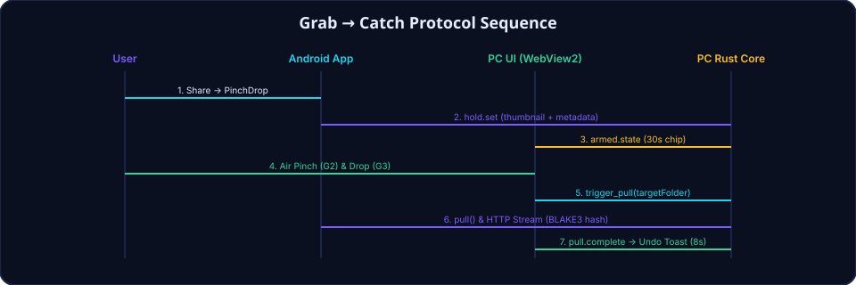
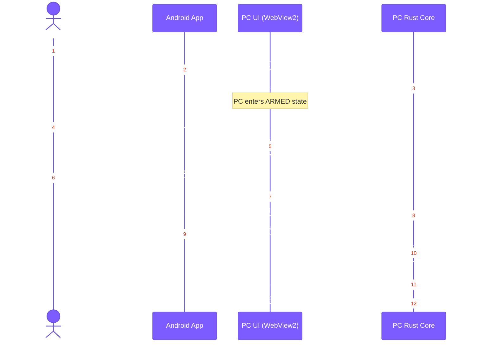
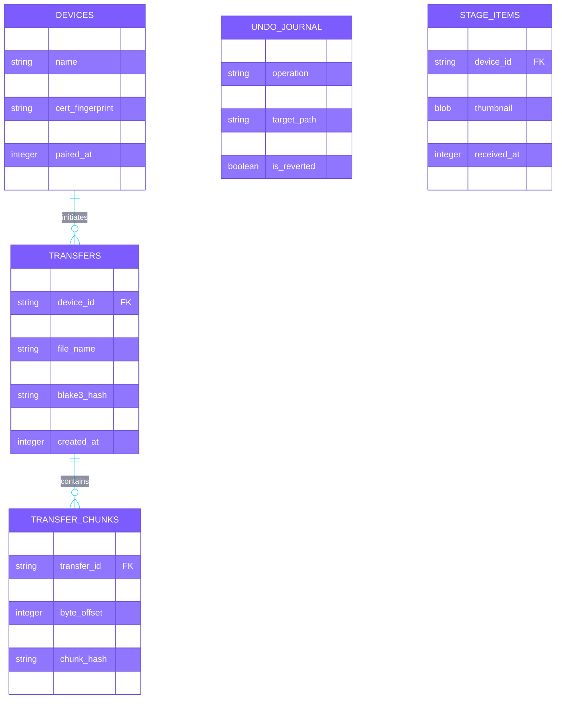

# architecture.md · Technical Architecture Specification



| Attribute | Specification |
|---|---|
| **Status** | 🟢 Locked Specification |
| **Owner** | Lead Systems Architect |
| **Last Updated** | 2026-11-24 |
| **Source of Truth For** | Component architecture, state machines, sequence diagrams, and pinned dependencies |

> [!NOTE]
> **Single Source of Truth:** This document defines the canonical technical architecture, threading models, data models, and dependency pins for PinchDrop.

---

## 1. System Context & Container Overview



### System Module Table

| Module | Location | Language | Core Responsibility | Owner Stage |
|---|---|---|---|---|
| `apps/desktop/src` | Desktop UI | TypeScript / React 18 | Air Workspace UI, Gesture HUD, Pointer Ring, Settings | Stage 3 (S3) |
| `packages/gesture-core` | Monorepo Pkg | TypeScript | One-Euro filter, landmark classifier, FSM, replay harness | Stage 2 (S2) |
| `apps/desktop/src-tauri` | Desktop Core | Rust (`tokio`) | Axum HTTP/WS server, TLS, `trash` file ops, BLAKE3 hasher | Stage 4 (S4) |
| `packages/protocol` | Monorepo Pkg | JSON Schemas | Canonical protocol schemas for TS, Rust (serde), Kotlin | Stage 0 / 2 |
| `apps/android` | Companion App | Kotlin / Compose | Share Target, Quick Settings tiles, WorkManager transfer | Stage 6 (S6) |

---

## 2. Gesture Pipeline & State Machine

```
Webcam Frame (30 fps)
       │
       ▼
MediaPipe Tasks-Vision (GPU Delegate)
       │ (21 landmarks: Wrist_0, Thumb_4, Index_8, Middle_9...)
       ▼
One-Euro Adaptive Smoothing Filter (minCutoff: 1.0, beta: 0.007)
       │
       ▼
Pinch & Pose Classifier (Scale-invariant ratio: L4-L8 / L0-L9)
       │
       ▼
Finite State Machine (FSM) ──► Custom UI Events (Hover, Grab, Drop, Undo)
```

### Finite State Machine (including ARMED state)





---

## 3. Communication & Transfer Sequences

### 3.1 Phone → PC (Grab → Catch Sequence)





### 3.2 PC → Phone (Throw Sequence)

1. User pinches a file or link card in the Air Workspace.
2. User executes a ballistic flick toward the screen edge representing the Phone Zone (velocity ≥ 0.6 screen-widths/s).
3. The PC UI signals the Rust core: `push.offer({itemId, fileMeta, targetPhone})`.
4. The PC core streams file chunks over local HTTP/1.1 Range to the Android companion app.
5. Android WorkManager writes chunks to MediaStore (`Pictures` / `Movies` / `Downloads`) and updates notification progress.
6. The PC displays an 8-second visual Undo toast (allowing immediate cancellation and removal).

---

## 4. File Safety Architecture

```
User Gesture Drop
       │
       ▼
Allow-List Boundary Check (Must reside inside user-designated roots)
       │
       ▼
Path Canonicalization & Reserved Name Sanitization (< > : " / \ | ? *)
       │
       ▼
Execution via Rust Engine (Atomic copy/move or Recycle Bin deletion)
       │
       ▼
Append Entry to SQLite Undo Journal
       │
       ▼
Trigger 8-Second Undo Toast on WebView2 UI
```

---

## 5. Data Models (SQLite / Room)



---

## 6. Pinned Technology Stack Versions

*Recorded as of November 2026:*

| Component | Technology | Version Pin | Purpose |
|---|---|---|---|
| **Desktop Shell** | Tauri | `^2.1.0` | Desktop container and IPC bridge |
| **Rust Compiler** | Rust Edition | `2021 (v1.82+)` | Backend systems core |
| **Async Runtime** | Tokio | `^1.41.0` | Asynchronous task execution |
| **HTTP/WS Server** | Axum | `^0.7.7` | Local secure transfer server |
| **TLS Engine** | Rustls | `^0.23.18` | Hardware-accelerated local TLS 1.3 |
| **File Deletion** | Trash crate | `^5.2.0` | Safe OS Recycle Bin routing |
| **Hashing Engine** | Blake3 | `^1.5.4` | High-throughput file chunk verification |
| **Desktop UI** | React | `^18.3.1` | View components |
| **Language** | TypeScript | `^5.6.3` | Type-safe frontend implementation |
| **Bundler** | Vite | `^5.4.10` | Fast HMR dev server |
| **CSS Framework** | Tailwind CSS | `^3.4.14` | Utility styling |
| **Animation** | Motion (Framer) | `^11.11.11` | 60 fps spring animations |
| **State Machine** | XState | `^5.19.0` | Gesture state transitions |
| **Vision SDK** | MediaPipe Tasks-Vision | `^0.10.17` | In-memory hand tracking |
| **Mobile OS** | Android | `minSdk 26, targetSdk 35` | Modern Android compatibility |
| **Mobile UI** | Jetpack Compose | `1.7.5 (BOM 2024.10.01)` | Reactive mobile UI |
| **Background Work** | WorkManager | `^2.9.1` | Android 15 dataSync transfers |

---

## 7. Architecture Decision Records (ADR Index)

- [ADR-0001: Tauri 2 + React 18 Desktop Shell](docs/adr/0001-tauri-desktop-shell.md)
- [ADR-0002: PC is Always Server, Phone is Always Client](docs/adr/0002-pc-server-phone-client.md)
- [ADR-0003: Stage Tray & Grab → Catch Sharing Architecture](docs/adr/0003-stage-tray-architecture.md)
- [ADR-0004: Android 15 dataSync Compliant Transfer Strategy](docs/adr/0004-android-background-strategy.md)
- [ADR-0005: Versioned JSON over WebSocket & HTTP Range Transfer](docs/adr/0005-protocol-architecture.md)
- [ADR-0006: Pure Deterministic TypeScript Gesture Core](docs/adr/0006-deterministic-gesture-core.md)
- [ADR-0007: Vendored Local Models and Zero Runtime CDN](docs/adr/0007-vendored-local-models.md)

---

[← Prev: product.md](product.md) · [Index](README.md) · [Next: rules.md →](rules.md)
