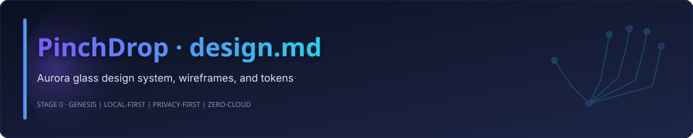
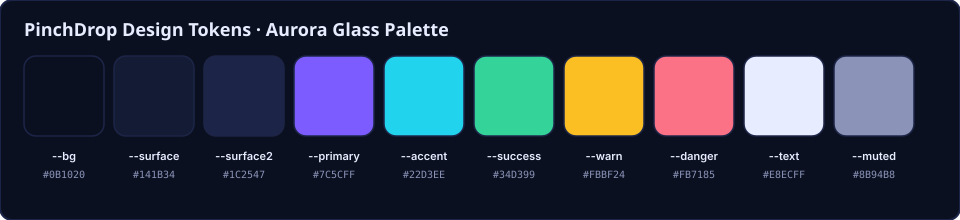

# design.md · Design System & UI Specifications



| Attribute | Specification |
|---|---|
| **Status** | 🟢 Locked Specification |
| **Owner** | Lead Product Designer |
| **Last Updated** | 2026-11-24 |
| **Source of Truth For** | Aurora glass tokens, wireframes, component states, and motion rules |

> [!TIP]
> **Design Feel:** Dark-first, "aurora glass", calm, futuristic, big, and bouncy. Every interactive target is designed to be easily acquired with a coarse hand gesture.

---

## 1. Design Principles

1. **Coarse Hand Ergonomics:** Minimum interactive target size is **96 px**. Targets magnetically snap the pointer when within 48 px.
2. **Forgiving Hysteresis:** State transitions require deliberate entry and exit thresholds (e.g. pinch enter ≤ 0.30, exit ≥ 0.45).
3. **Multi-Sensory Feedback:** Every gesture trigger provides synchronized visual glow, subtle spatial audio cues, and phone haptics.
4. **Non-Destructive Assurance:** High-risk actions require sustained holds (600–800 ms) and display an 8-second visual countdown Undo toast.

---

## 2. Canonical Color Palette & Tokens



### Dark Theme Tokens (Default)
```css
:root {
  --bg: #0B1020;         /* Deep space canvas */
  --surface: #141B34;    /* Cards and panels */
  --surface-2: #1C2547;  /* Raised cards & hover state */
  --primary: #7C5CFF;    /* Primary aurora purple, pointer ring */
  --accent: #22D3EE;     /* Phone zones, transfer streams, links */
  --success: #34D399;    /* Completed transfers, delivered status */
  --warn: #FBBF24;       /* ARMED state chip, countdown warnings */
  --danger: #FB7185;     /* Trash zone, delete confirmation */
  --text: #E8ECFF;       /* High-contrast body text */
  --muted: #8B94B8;      /* Secondary captions and inactive icons */
}
```

### Light Theme Tokens (v1.1)
```css
[data-theme="light"] {
  --bg: #F8FAFC;
  --surface: #FFFFFF;
  --surface-2: #F1F5F9;
  --primary: #6366F1;
  --accent: #0EA5E9;
  --success: #10B981;
  --warn: #F59E0B;
  --danger: #F43F5E;
  --text: #0F172A;
  --muted: #64748B;
}
```

---

## 3. Typography & Sizing Scale

- **Display & Headlines:** *Poppins* (SemiBold 600 / Bold 700)
- **Interface & Body:** *Inter* (Regular 400 / Medium 500 / SemiBold 600)
- **Code & Numbers:** *JetBrains Mono* (Regular 400)
- **Interactive Target Floor:** 96 px × 96 px minimum
- **Card Border Radius:** 20 px (standard), 28 px (oversized zones)
- **Spring Animations:** Stiffness 300, Damping 25 (Framer Motion)

---

## 4. UI Screen Wireframes

### 4.1 Air Workspace (Windows Desktop Overlay)

```
┌────────────────────────────────────────────────────────────────────────────────────────┐
│  [📷 Camera Active]     Air Workspace: /Users/Alex/Projects/         [⚙ Settings] [❌] │
├────────────────────────────────────────────────────────────────────────────────────────┤
│  ┌────────────────┐                                                ┌────────────────┐  │
│  │ 📱 PHONE ZONE  │   ┌──────────────┐  ┌──────────────┐           │   INBOX ZONE   │  │
│  │ (Drop to Send) │   │  Report.pdf  │  │  Photo1.jpg  │           │ (Throw Target) │  │
│  │                │   │    14 MB     │  │    4.2 MB    │           │                │  │
│  │   [Connected]  │   └──────────────┘  └──────────────┘           │    3 items     │  │
│  └────────────────┘                                                └────────────────┘  │
│                                       (o) Pointer Ring                                 │
│                       ┌──────────────┐                                                 │
│                       │  Design.fig  │                                                 │
│                       │    88 MB     │                                                 │
│                       └──────────────┘                                                 │
│  ┌────────────────┐                                                ┌────────────────┐  │
│  │  RENAME ZONE   │                                                │   TRASH ZONE   │  │
│  │  (Peace-Hold)  │                                                │ (Hold 600ms)   │  │
│  └────────────────┘                                                └────────────────┘  │
├────────────────────────────────────────────────────────────────────────────────────────┤
│  Stage Tray: [📷 Img_4821.jpg (Caught)] [🔗 github.com/pinchdrop]    [🔒 Fist to Lock] │
└────────────────────────────────────────────────────────────────────────────────────────┘
```

### 4.2 Undo Toast Component Wireframe
```
┌───────────────────────────────────────────────────────────────────────────┐
│ 🗑 Moved "Document.pdf" to Recycle Bin   [ ◷ 5.2s ]   [ ↩ UNDO GESTURE ] │
└───────────────────────────────────────────────────────────────────────────┘
```

### 4.3 Android Companion App Wireframe
```
┌────────────────────────────┐
│ PinchDrop Companion   [⚙]  │
├────────────────────────────┤
│  ● Connected to Alex-PC    │
│    Signal: Excellent       │
├────────────────────────────┤
│  QUICK GRAB ACTIONS        │
│  [ 📷 Latest Photo       ] │
│  [ 📋 Clipboard Link     ] │
│  [ 📄 Scan Document      ] │
├────────────────────────────┤
│  ACTIVE TRANSFERS          │
│  ↓ 4K_Broll.mp4            │
│  [▰▰▰▰▰▰▰▱▱▱] 72% 38 MB/s │
├────────────────────────────┤
│  STAGE TRAY (ON PC)        │
│  • Note_Nov24.txt (Sync'd) │
└────────────────────────────┘
```

---

## 5. Gesture Feedback Matrix

| Gesture | Visual Feedback | Audio Cue | Mobile Haptic |
|---|---|---|---|
| **G1 Point/Hover** | Pointer ring expands slightly (24px → 32px); card grows ×1.12 with magnetic pull. | Subtle air tick (low volume) | None |
| **G2 Pinch-Grab** | Ring snaps to point; card elevates with drop shadow and attaches to cursor. | Soft tactile pop | Light vibration |
| **G3 Release-Drop** | Card snaps into target slot with spring settle animation. | Soft mechanical click | Medium pulse |
| **G3b Throw** | Card streaks across screen with particle trail toward target edge. | Swift whoosh sound | Double crisp pulse |
| **G4 Peace-Hold** | Circular radial timer fills over 600ms, then keyboard slides in. | Gentle chime tone | Short buzz |
| **G5 Fist-Hold** | Screen edges dim; lock icon appears and counts down 800ms. | Descending sleep chime | Long buzz |
| **G6 Wave-Summon** | Entire workspace glass overlay fades in or out smoothly (250ms). | Airy ripple sound | None |

---

[← Prev: task.md](task.md) · [Index](README.md) · [Next: docs/gestures.md →](docs/gestures.md)
