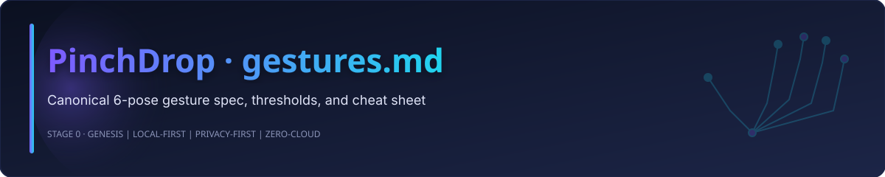
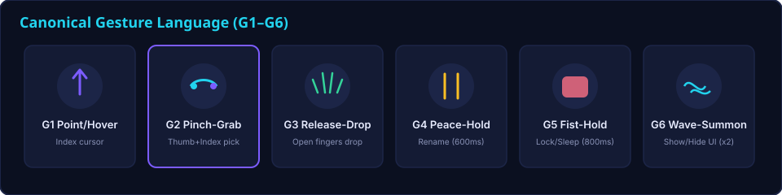

# Canonical Gesture Specification · `docs/gestures.md`



| Attribute | Specification |
|---|---|
| **Status** | 🟢 Locked Specification |
| **Owner** | Lead Computer Vision &amp; Interaction Engineer |
| **Last Updated** | 2026-11-24 |
| **Source of Truth For** | Hand landmark classifiers, One-Euro filter tuning, and gesture cheat sheet |

> [!IMPORTANT]
> **Design Philosophy:** Few, coarse, forgiving, and ergonomic. Maximum 6 hand poses in v1.0 plus 2 ballistic variants. The destination zone dictates *what* happens; the hand gesture dictates *when*.

---

## 1. Hand Landmarks & Pose Classifier Rules

Tracking leverages MediaPipe Tasks-Vision (21 3D landmarks):
- `0`: Wrist
- `4`: Thumb tip
- `8`: Index finger tip
- `9`: Middle finger MCP (base knuckle)
- `12`: Middle finger tip
- `16`: Ring finger tip
- `20`: Pinky finger tip



### Canonical Gesture Language Table

| ID | Name | Hand Pose &amp; Landmark Rules | Interaction Box Guard | Action Trigger |
|---|---|---|---|---|
| **G1** | **Point / Hover** | Open hand, Index tip (8) leading, Palm facing webcam. | Central 65% of camera frame mapped to full screen. | Moves smoothed cursor; triggers card hover. |
| **G2** | **Pinch-Grab** | Pinch ratio `dist(L4, L8) / dist(L0, L9) <= 0.30`. | Scale-invariant ratio + 120 ms dwell. | Picks up targeted card or ARMED item. |
| **G3** | **Release-Drop** | All fingers extended; pinch ratio `exit >= 0.45`. | Active drop zone hit test. | Drops item into folder or action zone. |
| **G3b** | **Throw** | Ballistic flick toward edge (velocity ≥ 0.6 screen-widths/s). | Edge direction cone + 8s Undo Toast. | Instantly sends to default Phone or Inbox. |
| **G4** | **Peace-Hold** | Index (8) &amp; Middle (12) extended; others curled; hold 600ms. | Radial countdown ring; aborts on motion. | Triggers Rename virtual keyboard overlay. |
| **G5** | **Fist-Hold** | All fingers curled into closed fist; hold 800ms. | Sleep guard; requires repeat 800ms to wake. | Locks gesture engine (0% camera CPU). |
| **G6** | **Wave-Summon** | Open palm lateral oscillation (2 cycles in ≤ 1.0s). | Frequency band filter. | Toggles Air Workspace overlay visibility. |
| **G7** | **Two-Hand Spread** | *(v1.1)* Both hands pinch and move apart. | Dual-hand stability filter. | Triggers multi-file batch lasso selection. |

---

## 2. Canonical Sharing Cheat Sheet

### 📱 → 💻 Phone to PC (After Grab on Phone; PC is ARMED for 30s)

| Hand Pose Glyph | You Do | Result |
|---|---|---|
| 🤏 | **Pinch anywhere** | Picks up newest held item (thumbnail attaches to pointer) |
| 🖐 | **Release over folder zone** | Saves file into that folder (+ 8s Undo Toast) |
| 🖐 | **Release over Open zone** | Opens immediately in default PC application |
| 🖐 | **Release over Browser zone** | Opens link in default PC web browser |
| 🖐 | **Release over Clipboard zone** | Copies image/text/link to PC clipboard |
| 💨 | **Throw (flick)** | Saves to default Inbox folder instantly (+ 8s Undo Toast) |
| 🖐 | **Release over Discard zone (or wait 30s)** | Dismisses ARMED state; item settles into Stage Tray |
| 🤏🤏 | **Two-hand pinch** | Takes all currently held items in batch |

### 💻 → 📱 PC to Phone (Pure Air Gesture; Phone Connected)

| Hand Pose Glyph | You Do | Result |
|---|---|---|
| 🤏 ➔ 🖐 | **Pinch card → release over Phone zone** | Streams file to phone (Photos → Gallery, Docs → Downloads) |
| 🖐 | **Release over Phone · Open zone** | Streams file and opens it directly on phone screen |
| 🖐 | **Release over Phone · Clipboard zone** | Copies text or URL onto phone system clipboard |
| 💨 | **Throw toward Phone edge** | Instantly sends file to default paired phone (+ 8s Undo Toast) |
| 🤏🤏 | **Two-hand lasso (v1.1)** | Selects multiple cards, then drop on Phone zone |

---

## 3. Tunable Filter & Gesture Thresholds

All thresholds are centralized in `GESTURE_CONFIG` within `@pinchdrop/gesture-core`:

```typescript
export const GESTURE_CONFIG = {
  APP_NAME: 'PinchDrop',
  PINCH_ENTER_THRESHOLD: 0.30,  // Scale-invariant enter ratio
  PINCH_EXIT_THRESHOLD: 0.45,   // Scale-invariant exit ratio (hysteresis)
  ONE_EURO: {
    minCutoff: 1.0,             // Jitter reduction at rest
    beta: 0.007,                // High-speed responsiveness
    dCutoff: 1.0,               // Derivative cutoff frequency
  },
  TIMING: {
    HOVER_DWELL_MS: 120,        // Dwell before hover confirmation
    RENAME_HOLD_MS: 600,        // Peace-hold duration for rename
    LOCK_HOLD_MS: 800,          // Fist-hold duration for sleep/wake
    TRASH_HOLD_MS: 600,         // Hold duration over Trash zone
    ACTION_COOLDOWN_MS: 400,    // Cooldown after drop action
    ARMED_TIMEOUT_MS: 30000,    // Phone grab timeout window
  },
  TARGETS: {
    MIN_INTERACTIVE_PX: 96,     // Minimum interactive card dimension
    MAGNETIC_SNAP_RADIUS_PX: 48,// Target attraction radius
  }
};
```

---

## 4. Delete Flow (Maximum Safety Guarantee)

```
Pinch-Grab Card
       │
       ▼
Carry to Trash Zone (Bottom Right)
       │
       ▼
Hold for 600 ms (Radial danger countdown fills: #FB7185)
       │
       ▼
Release Open Hand (G3)
       │
       ▼
Item Moved to OS Recycle Bin via `trash` crate
       │
       ▼
Show 8-Second Undo Toast with Reversal Action
```

Permanent file deletion is **never reachable by gesture**.

---

[← Prev: design.md](../design.md) · [Index](../README.md) · [Next: protocol.md →](protocol.md)
