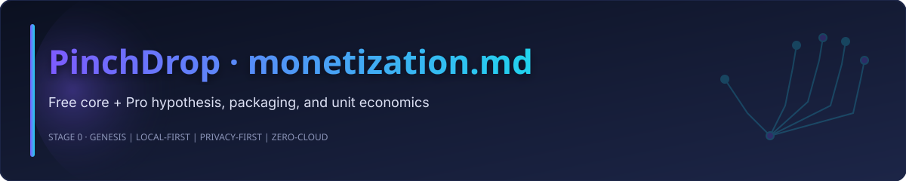

# Monetization & Unit Economics · `docs/monetization.md`

| Attribute | Specification |
|---|---|
| **Status** | 🟢 Locked Hypotheses |
| **Owner** | Lead Product Designer &amp; Project Manager |
| **Last Updated** | 2026-11-24 |
| **Source of Truth For** | Tier feature matrix, pricing hypotheses, and unit economics |

> [!NOTE]
> All pricing figures, conversion rates, and revenue projections in this document are **hypotheses to test** during beta, not forecasts.

---

## 1. Product Packaging & Tiers

File transfer is a commoditised utility (Google Quick Share, Microsoft Phone Link). Therefore, **we never cripple core file transfers**. Our differentiator is the physical, spatial interaction experience.

| Feature Area | Free Core (Forever) | Pro Tier (Hypothesis) |
|---|---|---|
| **Core Gestures** | All 6 gestures (Point, Pinch, Drop, Throw, Peace, Fist) | All 6 gestures + Custom gesture trainer |
| **Air Workspace** | Fullscreen spatial grid + oversized targets | Fullscreen spatial grid + Custom themes & layouts |
| **Device Pairing** | 1 Paired Smartphone at a time | Unlimited concurrent phones / tablets |
| **LAN Transfer Size** | Unlimited (Multi-GB 4K videos supported) | Unlimited high-throughput transfers |
| **Safety & Trash** | Recycle Bin deletion with 8s Undo toast | Recycle Bin deletion + Unlimited undo history |
| **Batch Selection** | Single item grab & catch | **Two-hand lasso multi-select** |
| **Smart Zones** | Fixed standard zones (Phone, Inbox, Rename, Trash) | **Automated rename templates (`{date}_{name}`)** |
| **System Cursor** | Air Workspace overlay only | **Explorer Mode (drive any Windows application)** |
| **Remote Access** | Local Wi-Fi network only | **Off-LAN encrypted relay service** |
| **Camera Mode** | Standard laptop webcam | **Phone-as-Camera HD LAN streaming** |

---

## 2. Pricing Hypotheses (To Test in Stage 12)

- **Monthly Subscription:** **US$ 3.99 / month** (India: **₹99 / month**)
- **Annual Subscription:** **US$ 29.00 / year** (India: **₹799 / year**)
- **Lifetime License:** **US$ 59.00 one-time** (India: **₹1,999 one-time**)
- **Educational / Accessibility:** Free institutional licenses for verified educators, students, and accessibility organizations.

---

## 3. Illustrative Revenue Scenarios (Model Only)

*Label: Illustrative model to evaluate unit economics, not a business forecast.*

| Active Users (Downloads) | Paid Conversion | Paying Users | Blended ARR / User | Illustrative Annual Net |
|---|---|---|---|---|
| **10,000 (Launch Year)** | 2.5% | 250 | $24.00 | **$6,000** |
| **50,000 (Growth Year)** | 3.5% | 1,750 | $24.00 | **$42,000** |
| **200,000 (Scale Year)** | 4.0% | 8,000 | $26.00 | **$208,000** |

---

## 4. Cost Model & Margins

- **Cloud Hosting:** **$0** (Local-first; no servers for file transfer).
- **Relay Bandwidth (Pro Only):** Offloaded to encrypted TURN/relay instances financed strictly by Pro subscriptions.
- **Fixed Overhead:** Windows Code Signing Certificate (~$250–$400/year), Google Play Developer Account ($25 one-time), Microsoft Store Developer Account ($19 one-time).

---

[← Prev: security-privacy.md](security-privacy.md) · [Index](../README.md) · [Next: adr/0001-tauri-desktop-shell.md →](adr/0001-tauri-desktop-shell.md)
