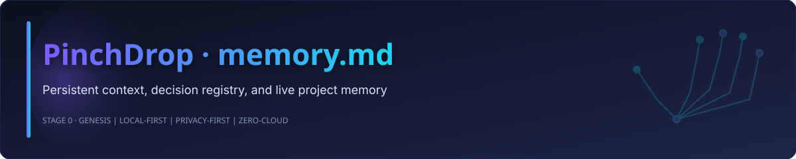

# memory.md · Project Memory & Decision Registry

| Attribute | Specification |
|---|---|
| **Status** | 🟢 Active |
| **Owner** | Lead AI Engineer &amp; Systems Architect |
| **Last Updated** | 2026-11-24 |
| **Source of Truth For** | Canonical decisions, project snapshot, glossary, gotchas, and open questions |

> [!NOTE]
> This file preserves persistent memory across agent turns. It follows an **append-only rule for decisions** and is updated at every project stage.

---

## 🧠 Project Snapshot

- **Current Phase:** **v1 rebuild — Phase P6 (Catch on phone)**. P1–P6 code is written; P2–P6 are not compiled yet because the dev PC is still downloading the MSVC build tools / Windows SDK and Gradle (the founder's editor, Antigravity IDE with the Red Hat Java extension, also auto-syncs the Android project and competes for the download). The earlier S3–S12 "done" stages were UI prototypes with mocked data (fake pairing, fake LAN server, prefix-only licence). On 2026-11-25 the founder approved a full v1 design (PC → phone only) and a 7-phase rebuild (P1–P7, see [task.md](task.md)).
- **Design reference:** "PinchDrop — Desktop & Mobile App Design" canvas (claude.ai artifact, private to the founder): every desktop + phone screen, pill/Island states, send animations, and the "How it works" spec.
- **Active Workspace:** `E:\Pinch Drop`
- **Next Phase:** **P7 — Polish & installers** (compile + fix everything once the toolchain is ready, signed Windows installer, release APK, error states, sounds).
- **Current Stack Status:**
  - Node.js `v20.19.5`, pnpm `12.18.0`, Rust `1.100` (MSVC), Tauri `2.x`
  - `apps/desktop`: Tauri 2 shell rebuilt in P1 — pill + Dynamic Island window, main window (onboarding, Home, Send, Transfers, Devices, Pair, Settings, Profile), tray, start-with-Windows, persistent settings. No phone connection yet (P3); "demo phone" preview setting stands in.
  - `@pinchdrop/gesture-core` (10 vitest tests) and `tools/gesture-lab` kept for P5.
  - `apps/android`: rebuilt in P2 — Kotlin + Jetpack Compose, Gradle wrapper 8.14.3, AGP 8.13, compileSdk 36. Every phone screen (Welcome, Permissions, Pair, Home, Received, Settings, Profile) plus DEMO previews of the incoming alert, Catch, Receiving and Photo-arrived animations. No PC connection yet (P3); "demo PC" preview setting stands in.
  - Protocol package: `packages/protocol` (JSON Schemas)

---

## 📜 Canonical Decision Log

| ID | Date | Decision | Rationale | Alternatives Considered | ADR Link |
|---|---|---|---|---|---|
| **DEC-0001** | 2026-11-24 | Tauri 2 + React 18 for Desktop Shell | Small installer (<60MB), safe Rust file ops, native WebView2 GPU acceleration for MediaPipe. | Python desktop (PyQt/Electron) — rejected due to massive bundle size and Python runtime friction. | [ADR-0001](docs/adr/0001-tauri-desktop-shell.md) |
| **DEC-0002** | 2026-11-24 | PC is Server, Phone is Client | Eliminates inbound connection blocks on Android and respects OS background execution limits. | Phone as server — rejected due to aggressive OS socket teardown. | [ADR-0002](docs/adr/0002-pc-server-phone-client.md) |
| **DEC-0003** | 2026-11-24 | Stage Tray & Grab → Catch Architecture | Webcam cannot see inside the phone. Bridge physical reality using Android Share Target / Tiles + PC ARMED state. | Direct camera OCR/vision of phone screen — physically impossible with laptop webcam angle. | [ADR-0003](docs/adr/0003-stage-tray-architecture.md) |
| **DEC-0004** | 2026-11-24 | Android 15 `dataSync` Compliant Transfer Strategy | Android 15 limits `dataSync` foreground services to 6 hours per 24h. Use foreground sessions + WorkManager. | Always-on background service — rejected because Android 15 kills non-compliant services. | [ADR-0004](docs/adr/0004-android-background-strategy.md) |
| **DEC-0005** | 2026-11-24 | Versioned JSON over WebSocket + HTTP Range Transfer | Reliable low-overhead bi-directional control with resume-capable chunked file transfers. | gRPC / Raw TCP sockets — heavier runtime, complex cross-language bindings. | [ADR-0005](docs/adr/0005-protocol-architecture.md) |
| **DEC-0006** | 2026-11-24 | Pure TS Deterministic Gesture Core with Replay Harness | Allows testing gesture classification, smoothing, and FSM against pre-recorded landmark sessions in CI. | Coupling gesture logic to DOM/React components — untestable in headless CI. | [ADR-0006](docs/adr/0006-deterministic-gesture-core.md) |
| **DEC-0007** | 2026-11-24 | Vendored Offline Models & Zero CDN Runtime | Ensures complete offline capability and satisfies zero-cloud privacy commitments. | Runtime CDN fetching (unpkg/cdnjs) — violates privacy and breaks without internet. | [ADR-0007](docs/adr/0007-vendored-local-models.md) |
| **DEC-0008** | 2026-11-25 | Dedicated External Services & Credentials Registry | Centralize developer credentials, keystores, and store accounts into `docs/services.md` with zero-leak policy. | Fragmented instructions in individual app READMEs. | [Services Guide](docs/services.md) |
| **DEC-0009** | 2026-11-25 | Client-Side Gesture Gym & Privacy Dashboard | Provide users immediate tactile confidence with gamified gesture calibration and zero-recording verification. | Relying on static documentation manuals or external web tutorials. | [Task Board](task.md) |
| **DEC-0010** | 2026-11-25 | Procedural Web Audio API for Zero-Asset Sound Design | Synthesize tactile audio cues (pop, click, whoosh, thud, chime) directly in Web Audio without shipping heavy audio files. | Bundling static WAV/MP3 audio assets — increases bundle size and incurs decode latency. | [Design Spec](design.md) |
| **DEC-0011** | 2026-11-25 | Minisign Ed25519 & Dual Windows Installers (NSIS + MSI) | Dual-installer strategy guarantees consumer ease (NSIS setup wizard) and enterprise IT compatibility (silent MSI deployment). | MSI-only or Portable ZIP only — limits consumer adoption and IT administration. | [Services Guide](docs/services.md) |
| **DEC-0012** | 2026-11-25 | Offline-First Zero-Phone-Home Licensing Verification | Enforce Pro tier unlocks via local signature parsing and persistent JSON state without cloud DRM telemetry. | Server-backed cloud licensing / DRM — violates zero-telemetry privacy promise. | [Monetization Spec](docs/monetization.md) |
| **DEC-0013** | 2026-11-25 | v1 = PC → phone only, rebuilt in 7 phases (P1 shell → P7 installers) | Earlier stages were mock-ups; a real end-to-end path beats breadth. Phone → PC, Throw, rename/lock gestures and Pro come after v1. | Keep extending the prototype code — rejected: fake pairing/server/licence could not be built on. | [task.md](task.md) |
| **DEC-0014** | 2026-11-25 | Pill is its own always-on-top window that resizes to its content | Transparent areas of a WebView2 window still swallow clicks, so the window must be exactly pill- or Island-sized; Rust keeps the anchored edge fixed while resizing. | One large transparent overlay window — rejected: blocks clicks on apps underneath. | [task.md](task.md) |
| **DEC-0016** | 2026-11-25 | Link = WebSocket over TLS with a pinned self-signed PC certificate; pairing by QR or mDNS + 6-digit SAS code; reconnect by HMAC proof | No accounts or cloud; the QR carries the fingerprint so the phone can't be fooled, and the code catches a man-in-the-middle when the list is used instead. Spec: [LINK-v1](packages/protocol/LINK-v1.md). | Mutual TLS with phone certificates — more moving parts on Android for no real gain in v1; plain HTTP on the LAN — rejected (privacy). | [LINK-v1](packages/protocol/LINK-v1.md) |
| **DEC-0017** | 2026-11-25 | Transfers: the phone pulls chunks over the existing link; files addressed by index in the offer | Pull gives natural flow control and resume-from-bytes-on-disk; index addressing means a phone can never read a path the user didn't pick. One socket, already authenticated. | Separate HTTP range server — a second port, second auth path, more firewall prompts. | [LINK-v1 §6](packages/protocol/LINK-v1.md) |
| **DEC-0018** | 2026-11-25 | Hand tracking runs in a click-through full-screen `overlay` webview, shown only while the camera may run | A visible webview isn't throttled, can draw the ring and card anywhere, and `set_ignore_cursor_events` keeps every click going to the apps underneath. MediaPipe Tasks (WASM + model) ship inside the app. | Hidden webview — throttled when hidden; native (Rust) inference — no maintained MediaPipe binding. | [task.md](task.md) |
| **DEC-0019** | 2026-11-25 | Camera runs only after the user clicks the pill (or presses the hotkey) and switches off after 30 s without activity; only pinch and open hand are acted on | Founder request: no continuous camera access, predictable on/off, no accidental actions from other hand movements. | Camera on whenever something is selected (previous default) — still available as an option, but too easy to have the camera on unknowingly; always-on mode removed. | [task.md](task.md) |
| **DEC-0021** | 2026-11-25 | Phone → PC "lift": the phone holds the item, the PC pulls it (LINK-v1 §6.5); the PC webcam turns on by itself only while a lift is in the air | Mirrors the proven PC → phone pull engine; the user started it on the phone (Share + pinch), which counts as asking for the camera; it's bounded by the 30 s catch window. Saves only to Downloads\PinchDrop with sanitised names. | Phone pushes data unasked (no back-pressure, harder to cancel); copying into the phone app first (slow for videos). | [packages/protocol/LINK-v1.md](packages/protocol/LINK-v1.md) |
| **DEC-0020** | 2026-11-25 | Default look is fresh white (Apple-style greys + blue); the pill/Island stay jet black | Founder disliked the navy dark palette and asked for something premium and white like Apple. A black Island reads on any wallpaper, like the iPhone's. | Keep the navy Aurora dark theme — rejected by the founder. Dark remains optional (graphite / true black). | [task.md](task.md) |
| **DEC-0015** | 2026-11-25 | Default send mode is copy; "move" recycles the PC file only after the phone confirms | Never lose a file to a dropped connection; still no permanent deletes. | Move by default — rejected as risky. | [task.md](task.md) |

---

## 🔤 Project Glossary

- **Air Workspace:** The desktop overlay UI featuring oversized folder targets, action zones, and magnetic card snapping.
- **ARMED State:** Transient 30-second window on the PC triggered when the paired phone sends a `hold.set` payload. Pinching anywhere during ARMED catches the item.
- **Grab → Catch:** The two-step sharing interaction bridging phone and PC: user taps Share on phone (Grab), then executes a mid-air pinch on PC (Catch).
- **Stage Tray:** Persistent staging area on PC hosting items sent from phone that were not caught during the initial 30-second ARMED window.
- **Interaction Box:** Central 60–70% boundary of the webcam frame mapped to 100% of the PC display screen, preventing awkward arm over-extension.
- **One-Euro Filter:** Adaptive low-pass filter providing jitter reduction at low velocities and lag elimination at high velocities.
- **Pinch Ratio:** Scale-invariant ratio calculated as `dist(ThumbTip_4, IndexTip_8) / dist(Wrist_0, MiddleMCP_9)`.
- **Throw Gesture (G3b):** High-velocity ballistic flick toward a screen edge that triggers instant transfer to the default destination without fine aiming.
- **Zones:** Dedicated screen edge drop targets: Phone Zone, Quick Folders, Rename Zone, Browser Zone, Clipboard Zone, and Trash Zone.

---

## ⚠️ Gotchas & Technical Learnings

1. **Android 15 Foreground Service Limits:** `dataSync` foreground services are capped at ~6 hours in a rolling 24-hour window. Service timers reset when the user brings the app to the foreground. PinchDrop must rely on user-initiated jobs and WorkManager.
2. **Wi-Fi Client / AP Isolation:** Public and university Wi-Fi networks frequently block direct peer-to-peer LAN sockets. Fallbacks: Wi-Fi Hotspot, USB tethering, or `adb reverse` (dev only).
3. **WebView2 Camera Access:** Requires explicit permission initialization and camera device selection inside the Tauri WebView runtime.
4. **Windows Reserved File Characters:** Paths containing `< > : " / \ | ? *` or reserved names (`CON`, `PRN`, `AUX`, `NUL`) must be sanitized before disk writes.
5. **SmartScreen & Code Signing:** Unsigned Windows binaries encounter severe SmartScreen warnings. Stage 11 must introduce valid code signing certificates.
6. **No-CDN Policy:** All MediaPipe WASM binaries and HandLandmarker `.task` model files must be bundled inside the desktop package.
7. **Android camera from background:** Android does not let an app start the camera (or any screen) from the background. Fix: with "Display over other apps" (`SYSTEM_ALERT_WINDOW`) allowed, the app may start its Catch screen itself; on Xiaomi/HyperOS the extra "Open new windows while running in the background" switch is also needed. The hold alert carries a full-screen intent (lock screen) and stays as the fallback.
8. **Transparent WebView2 windows still capture clicks** in their transparent parts — keep the pill window sized to its content.
9. **Android build needs `local.properties`** (`sdk.dir=...`, not committed) or `ANDROID_HOME`. Only SDK platform 36 is installed on the dev PC, so compileSdk is 36.
10. **Slow first builds on the dev PC:** the first Gradle and MSVC builds download hundreds of MB to GB; on the founder's connection that took over an hour. Later builds are offline from caches.
11. **Windows Firewall:** the first time PinchDrop opens port 47821, Windows asks; it must be allowed on *private* networks or phones can't connect.
12. **Explorer selection:** read via Shell COM (`IShellWindows` → `IShellBrowser` → `IFolderView::Items(SVGIO_SELECTION)`). Windows 11 tabs share one top-level HWND, so only the tab whose view window is visible counts. Desktop = `FindWindowSW(CSIDL_DESKTOP, SWC_DESKTOP)`.
13. **Smooth pill/Island:** measure the content with `offsetWidth/offsetHeight` (layout size), never `getBoundingClientRect` (includes animation transforms → an OS window resize on every frame = stutter). The window grows once before the morph and shrinks once after it. Hand ring/card move via framer-motion motion values set from the camera loop, not React state.
14. **Island content swaps:** AnimatePresence can *reuse* an exiting element when the Island re-opens quickly (hold → send), so ref callbacks don't fire again. The pill finds the current box by `data-box` after every render and re-observes it.
15. **Overlay flashes:** every arm-state change used to hide the overlay; a short "fx playing" window now keeps it up until the send animation finishes.
16. **Shell thumbnails:** `IShellItemImageFactory::GetImage(256, SIIGBF_THUMBNAILONLY)` on its own STA thread (1.5 s cap). Bitmaps are premultiplied BGRA, or alpha all zero for opaque JPEGs — fix both before PNG-encoding.

---

## ❓ Open Questions & Decisions Needed

1. **Name & Trademark Check:** `PinchDrop` is a working title. Need formal trademark, domain, and store-name availability check. (Recommendation: Keep name abstracted in `GESTURE_CONFIG.APP_NAME`).
2. **Python Vision Spike vs. Pure JS/Rust:** Should we write a throwaway Python MediaPipe script for calibration or proceed directly to Stage 1 Gesture Lab in Vite/TS? (Recommendation: Skip Python spike; Stage 1 in Vite/TS validates WebView2 directly).
3. **Google Photos Original Quality Handover:** Does the Android Share Sheet provide the original raw file or a downsampled version from Google Photos cloud cache? (Recommendation: Validate with real Android device in Stage 7).
4. **Offline Voice Rename Engine:** For Stage 1.1 voice rename, should we bundle `whisper.cpp` as a sidecar or leverage Windows Speech Recognition APIs? (Recommendation: Test whisper.cpp sidecar for privacy and cross-version consistency).
5. **Distribution Priority:** Windows Direct Download (MSI/NSIS) vs. Microsoft Store submission first. (Recommendation: Direct NSIS installer first for rapid beta iteration).
6. **Commercial Licensing Strategy:** Dual-license (AGPLv3 for open core + Commercial for Pro) vs. Source-Available. (Recommendation: Clarify before Stage 12).

---

## 🙋 Founder Preferences

- **Aesthetic:** Highly polished, colourful, dark-first "aurora glass" aesthetic.
- **Quality Standard:** Rock-solid reliability; no glitchy camera stutter; forgiving thresholds.
- **Working Style:** Solo builder, part-time (~15–20 hours/week), clean documentation.

---

[← Prev: AGENTS.md](AGENTS.md) · [Index](README.md) · [Next: product.md →](product.md)
