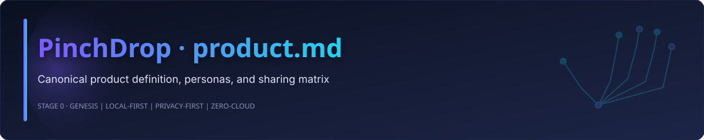

# product.md · Canonical Product Specification



| Attribute | Specification |
|---|---|
| **Status** | 🟢 Locked Specification |
| **Owner** | Lead Product Designer &amp; Systems Architect |
| **Last Updated** | 2026-11-24 |
| **Source of Truth For** | Product vision, personas, MoSCoW scope, Sharing Matrix, and success metrics |

> [!TIP]
> **Product Vision:** Move things with your hands. PinchDrop transforms file transfer and desktop organisation from a chore of menus and cables into an intuitive, tactile spatial interaction.

---

## 1. Problem & Solution

### The Problem
Moving files, photos, and links between a PC and a smartphone is a fragmented experience. Existing solutions either require physical cables, multi-step Share Sheet dialogues, or generic pointer emulators that cause extreme shoulder strain ("gorilla arm") when trying to hit tiny 16 px desktop icons.

### The Solution
PinchDrop combines local hand-tracking computer vision with a dedicated spatial desktop workspace and a mobile companion app. Users interact via **burst gestures** (2–8 seconds) on oversized cards (96+ px) and screen edge zones, backed by the **Grab → Catch** model and instant undo safety.

---

## 2. Competitive Landscape

*Marked as of November 2026; re-verify prior to public launch.*

| Group | Examples | Strengths | What They Lack vs. PinchDrop |
|---|---|---|---|
| **Phone↔PC File Transfer** | Google Quick Share for Windows, Microsoft Phone Link, LocalSend, KDE Connect | High reliability, ubiquitous protocols, background transfer. | No spatial interaction, no gesture support, standard small desktop menus. |
| **Webcam Gesture Input** | AirTouch (Neural Lab), UCL MotionInput, Gestura, MediaPipe open-source projects | Cursor tracking, presentation controls. | No phone awareness, no dedicated file UI, severe precision fatigue on desktop icons. |
| **Gesture Transfer Demos** | Air Flick research demos, Huawei gesture transfer concept | Visually compelling demos. | Lab prototypes only; images only; lack production Android client, safety journal, or resume engine. |

---

## 3. Target Personas

```
┌────────────────────────────────────────────────────────────────────────────────────────┐
│ P1: The Knowledge Worker & Student                                                    │
│ Core Need: Transfer lecture slides, PDFs, notes, and photos between devices all day.  │
│ PinchDrop Moment: Pinches a phone photo off the screen and drops it into Word in 2s.  │
└────────────────────────────────────────────────────────────────────────────────────────┘
┌────────────────────────────────────────────────────────────────────────────────────────┐
│ P2: The Video & Photo Creator                                                         │
│ Core Need: Move multi-GB 4K footage and b-roll batches; triage rush folders quickly.   │
│ PinchDrop Moment: Two-hand lasso sweep over 20 video clips, throwing them to PC Inbox.│
└────────────────────────────────────────────────────────────────────────────────────────┘
┌────────────────────────────────────────────────────────────────────────────────────────┐
│ P3: The Teacher & Presenter                                                           │
│ Core Need: Show documents and advance materials while standing away from the keyboard.│
│ PinchDrop Moment: Waves hand to summon workspace and pinches a diagram into view.     │
└────────────────────────────────────────────────────────────────────────────────────────┘
┌────────────────────────────────────────────────────────────────────────────────────────┐
│ P4: The Accessibility User (RSI / Fine Motor Challenges)                              │
│ Core Need: Low-strain, pointer-free, large-target computer interaction.               │
│ PinchDrop Moment: Dwell-to-select and magnetic target snapping eliminate mouse strain. │
└────────────────────────────────────────────────────────────────────────────────────────┘
┌────────────────────────────────────────────────────────────────────────────────────────┐
│ P5: Hands-Busy Contexts (Cooking, Workshop, Hardware Lab)                             │
│ Core Need: Control PC displays and preview schematics without touching hardware.      │
│ PinchDrop Moment: Inspecting a recipe or PDF without touching the keyboard with dough.│
└────────────────────────────────────────────────────────────────────────────────────────┘
```

---

## 4. Feature Scope (MoSCoW)

### 🟢 MUST Have (v1.0 Public Launch)
- `F-001` **Gesture Engine:** Real-time MediaPipe hand tracking, One-Euro smoothing, G1–G6 gesture classifier, interaction box mapping.
- `F-002` **Gesture Gym:** First-run calibration and interactive training playground.
- `F-003` **Air Workspace (Windows):** Fullscreen overlay grid, 96+ px interactive cards, edge zones (Phone, Inbox, Rename, Trash), breadcrumbs.
- `F-004` **Safe File Operations:** Move, copy, rename, and folder creation. Deletion strictly via Recycle Bin (`trash` crate) with 8s Undo Toast.
- `F-005` **PC → Phone Transfer:** Pinch file/link, release over Phone Zone; streamed via local TLS with BLAKE3 hash verification.
- `F-006` **Phone → PC Grab → Catch:** Share Sheet target on Android, Quick Settings tiles, PC ARMED state (30s), mid-air catch to folder.
- `F-007` **Air Clipboard:** Bi-directional text and URL synchronization; "Open on other device" action.
- `F-008` **Local Pairing:** Mutual QR code authentication with pinned certificate fingerprints; device revocation.
- `F-009` **Privacy Dashboard:** Real-time camera status, local-only verification, one-click camera kill switch.
- `F-010` **Accessibility Suite:** Left/right-hand modes, dwell-to-select alternative, reduced motion, high contrast theme.
- `F-011` **Packaging & Updates:** Signed MSI/NSIS Windows installer and Play-Store-ready Android APK/AAB.

### 🟡 SHOULD Have (v1.1 / v1.2)
- `F-012` Batch two-hand lasso selection.
- `F-013` Quick Look file preview on hover.
- `F-014` Phone-as-Camera streaming over local LAN.
- `F-015` Smart Zones with automated date/template renaming (`{date}_{name}`).
- `F-016` Offline voice rename using local speech model.
- `F-017` Light mode UI theme tokens.
- `F-018` Localization framework (English + Hindi initial release).

### 🔵 COULD Have (v2+)
- `F-019` Explorer Mode: System-wide virtual cursor driving native Windows applications.
- `F-020` Media & presentation control gestures (Palm pause, Pinch-spread zoom).
- `F-021` Media Triage swipe deck for rapid photo cleanup.
- `F-022` Off-LAN encrypted relay service (Pro).
- `F-023` Multi-phone concurrent pairing.
- `F-024` macOS & Linux desktop ports (via Tauri 2).
- `F-025` iOS companion app (PWA + Share Extension).

### ⛔ WON'T Have (v1.0)
- Cloud storage or cloud file hosting.
- User accounts or identity providers.
- Chat, social sharing, or public links.
- Remote access across the open internet.
- Permanent file deletion gesture.

---

## 5. Canonical Sharing Matrix

*(Copy verbatim into all user documentation)*

| Content | 📱→💻 Grab Source (Phone) | 📱→💻 Land Target (PC) | 💻→📱 Pinch Source (PC) | 💻→📱 Land Target (Phone) |
|---|---|---|---|---|
| **Photos** | Share → PinchDrop (Google Photos etc.) · tile "Grab latest photo" · Peek | Folder · Open in default app · PC clipboard (paste anywhere) · Inbox (Throw) | Image files | Gallery (MediaStore Pictures) |
| **Videos / movies** | Share → PinchDrop · Peek | Folder · Open · Inbox | Video files (multi-GB OK) | Movies folder (MediaStore) |
| **Screenshots** | Tile "Grab latest screenshot" · Share | Folder · PC clipboard | Region/screen capture card (v1.1) | Gallery |
| **Documents, PDFs, any file** | Share → PinchDrop (from Files, Drive, WhatsApp…) | Folder · Open · Inbox | Any file | Downloads (MediaStore/SAF) · **Open on phone** zone launches it |
| **Folders** | Pick folder in app (v1.1) | Folder | Folder (sent as a stream/zip) | Downloads/PinchDrop |
| **Links / URLs** | Share → PinchDrop (from Chrome, YouTube, Maps…) | **Open in PC browser** zone · Clipboard · Notes file | Link card (from clipboard/browser extension, v1.1) | **Open on phone** zone (opens in phone browser) |
| **Text / notes / snippets** | Share → PinchDrop · tile "Grab clipboard" | Clipboard · `.txt` in folder | Text card / selection | Phone clipboard · note file |
| **Scanned document** | In-app ML Kit scanner → PDF straight to PC | Folder · Open | — | — |
| **Camera capture / voice memo** | In-app capture straight to PC tray | Folder · Open | — | — |
| **Many items at once** | Multi-select share (`ACTION_SEND_MULTIPLE`) | Two-hand pinch = take all | Lasso (two-hand, v1.1) | Same zones |

### Honest Technical Constraints to Document
1. **Phone Connectivity:** 💻→📱 transfer requires the phone to be connected (app active or user-initiated Connected session). Android 15 caps `dataSync` foreground services at 6 hours/day.
2. **Share Sheet Resolution:** Android Share Sheet handles file dispatch; verification is required to ensure Google Photos provides full-resolution originals (`❓ OPEN`).
3. **Scoped Storage Permissions:** Peek mode and "latest photo" tiles require granular media permissions (Android 14+ partial photo access).
4. **Clipboard Security:** Reading the Android clipboard requires the app to briefly transition to the foreground via a transient overlay.
5. **Privacy Scope:** Contacts, SMS, push notifications, and private app data are strictly out of scope.

---

## 6. Success Metrics & Hypotheses

*All metrics are targets and hypotheses to validate during testing:*

- **Activation Time:** New user successfully performs their first air "Throw" within **< 2 minutes** of completing Gesture Gym.
- **Gesture-to-Pixel Latency:** p95 latency **≤ 60 ms** on integrated laptop GPUs at 60 fps.
- **False-Trigger Rate:** **< 1 false trigger per hour** of typical desktop typing and resting behavior.
- **Transfer Soak Reliability:** 100% transfer completion on **5 GB continuous file transfers** over local Wi-Fi with < 150 MB RAM growth.
- **D7 Retention (Hypothesis):** ≥ 35% weekly active users among paired-device users.
- **Free-to-Pro Conversion (Hypothesis):** 3–5% conversion rate on power users using batch lasso and Smart Zones.

---

[← Prev: memory.md](memory.md) · [Index](README.md) · [Next: architecture.md →](architecture.md)
