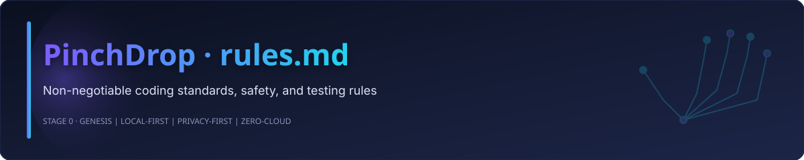

# rules.md · Project Rules & Engineering Guidelines

| Attribute | Specification |
|---|---|
| **Status** | 🟢 Locked Rules |
| **Owner** | Lead AI Engineer &amp; Systems Architect |
| **Last Updated** | 2026-11-24 |
| **Source of Truth For** | Non-negotiables, coding standards, safety rules, and DoD |

> [!CAUTION]
> **Zero Tolerance Violations:** Permanent file deletion via gesture, runtime CDN usage, and uncontained file modifications outside the allow-list are strictly forbidden.

---

## 1. Absolute Non-Negotiables

1. **Safety First:** Permanent file deletion (`std::fs::remove_file`) via gesture is strictly prohibited. Deletions must route to the OS Recycle Bin via the `trash` crate, accompanied by an 8-second visual toast and undo journal record.
2. **Local-First Privacy:** Video frames must remain in volatile memory. Camera frames and landmark coordinates must never be written to persistent storage or sent over the network.
3. **Offline Runtime (No CDNs):** No runtime asset or model fetching from external CDNs. All WASM, TFLite, and UI assets must be locally vendored.
4. **Allow-List File Containment:** All file system read, write, and move operations must be validated against user-approved folder roots. All paths containing `..` or forbidden Windows characters must be rejected.
5. **Docs & Code Synchronization:** Any modification to thresholds, gestures, data models, or pricing must be updated across all affected Markdown files in the same commit.

---

## 2. Coding Standards by Language

### TypeScript / React
- Strict type checking enabled (`strict: true`). Zero `any` types allowed without written justification.
- State machines implemented via XState or pure reducers with deterministic transitions.
- Functional components with React 18 hooks; performance-critical gesture loops must avoid unnecessary re-renders.

### Rust (`apps/desktop/src-tauri`)
- Zero warnings under `cargo clippy -- -D warnings`.
- No unchecked `.unwrap()` calls in production code; use `Result<T, AppError>` and `?` operator.
- Async I/O managed strictly via `tokio`.

### Kotlin (`apps/android`)
- Adhere to official Kotlin coding conventions and pass `ktlint` / `detekt`.
- UI implemented purely in Jetpack Compose (Material 3).
- Strict adherence to Android 15 `dataSync` foreground service constraints and WorkManager.

---

## 3. Testing Policy & Coverage Floors

| Module | Test Framework | Minimum Coverage Floor | Test Strategy |
|---|---|---|---|
| `@pinchdrop/gesture-core` | Vitest | **≥ 90%** | Landmark session replay harness, jitter benchmarks |
| Rust Core File Ops | `cargo test` | **≥ 90%** | Allow-list boundary validation, undo journal recovery |
| Desktop UI | Playwright / Vitest | ≥ 80% | Card interaction, zone hit-testing, toast dismissal |
| Android Companion | JUnit / Espresso | ≥ 75% | Share Sheet receipt, thumbnail caching, chunk resume |

---

## 4. Git & Branching Workflow

- **Granular Commit Policy:** Create a dedicated Git commit **immediately after creating or editing each individual file**. Never batch multiple unrelated files into a single commit.
- Branch naming: `stage-<n>-<slug>` (e.g. `stage-1-gesture-lab`) or directly on `main` as instructed.
- Commit style: **Conventional Commits** (`docs:`, `chore:`, `feat:`, `fix:`, `refactor:`, `test:`).
- Push all accumulated commits at the end of the stage milestone.

---

## 5. Things the Agent Must NEVER Do

- ❌ Never commit hardcoded secrets, private keys, or certificates.
- ❌ Never use external network calls in tests or offline build scripts.
- ❌ Never bypass the `trash` crate for file deletion.
- ❌ Never allow path traversal outside the user allow-list.
- ❌ Never leave undocumented `TBD` placeholders without ownership or context.

---

[← Prev: architecture.md](architecture.md) · [Index](README.md) · [Next: task.md →](task.md)
