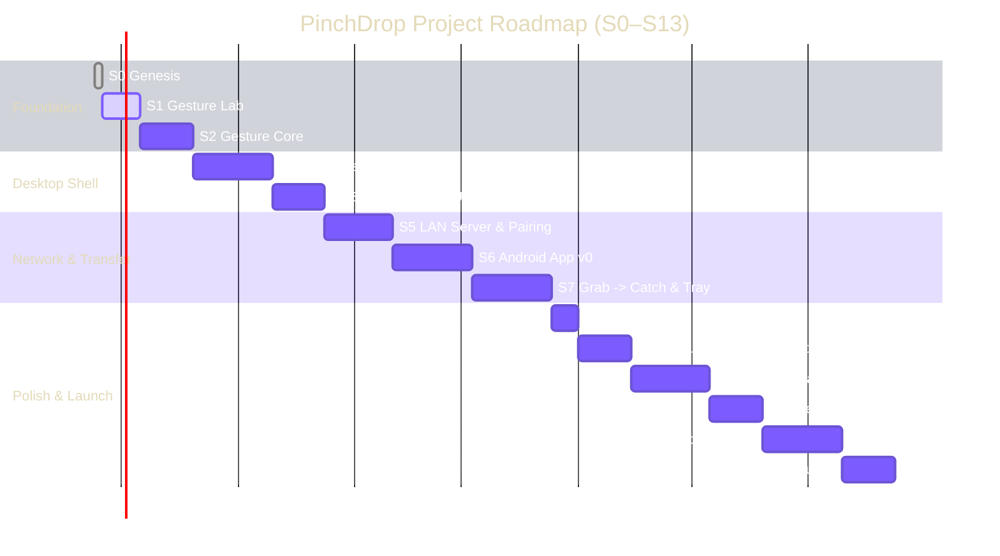

# task.md · Master Task Board & Roadmap

| Attribute | Specification |
|---|---|
| **Status** | 🟢 Live Board |
| **Owner** | Lead AI Engineer &amp; Project Manager |
| **Last Updated** | 2026-11-24 |
| **Source of Truth For** | Roadmap tracking (S0–S13), sprint tasks, and backlog |

> [!NOTE]
> **v1 rebuild in progress — Phase P3 of 7.** P1 and P2 code done (founder checks P1.7 / P2.7 open). P3 code written, not yet compiled — the dev PC is still downloading the C++ build tools and Gradle. The S0–S13 table below records the earlier prototype stages; their UI and Rust code were mock-ups and are being replaced phase by phase.

---

## 🚀 v1 Build Phases (P1–P7) — PC → phone

Approved 2026-11-25 together with the full screen design (see [memory.md](memory.md) → Design reference). Each phase ends with something the founder can run.

| Phase | Name | You test | Status |
|---|---|---|---|
| **P1** | **Desktop shell** — pill, Dynamic Island, main window screens, tray, start with Windows, settings | Run the `.exe` | 🟢 Built — founder check open |
| **P2** | **Android app shell** — every phone screen, permission flow, settings | Install the APK | 🟢 Written — build + founder check open |
| **P3** | **Real connection** — discovery, QR + 6-digit pairing, encrypted link, live phone name + battery | Pair your phone | 🟡 In progress |
| **P4** | **Manual send** — files, folders, text; Gallery / Downloads saving; receive animations; history; resume | Send real files | ⚪ Pending |
| **P5** | **Grab on PC** — Explorer/Desktop selection, webcam pinch, floating card, Island countdown | Pinch a folder | ⚪ Pending |
| **P6** | **Catch on phone** — incoming alert, camera open-hand detection, full gesture loop | The whole thing | ⚪ Pending |
| **P7** | **Polish & installers** — sounds, haptics, error states, Windows installer, release APK | Install fresh | ⚪ Pending |

### P1 · Desktop shell
- [x] `P1.1` Tauri 2 shell rebuilt: `main` + `pill` windows, single instance, tray menu (Open, Send, Show pill, Settings, Quit).
- [x] `P1.2` Persistent settings (`settings.json` in the app config folder) shared live between windows.
- [x] `P1.3` Pill: always on top, click → Island, double-click → app, drag anywhere with edge snapping + remembered position, right-click menu, sizes S/M/L, hide in full-screen apps, hide for 1 hour.
- [x] `P1.4` Dynamic Island: phone name, battery, network, Send files, gestures on/off, open app, auto-close.
- [x] `P1.5` Main window: first-run setup, Home (drop area + connected phone panel), Send (real file/folder picking and drag-drop with sizes), Transfers, Devices, Pair, Settings (every option), Profile.
- [x] `P1.6` Start with Windows, light/dark theme, reduced motion, demo-phone preview.
- [ ] `P1.7` Founder check on a real Windows desktop (multi-monitor, high-DPI).

### P2 · Android app shell
- [x] `P2.1` Gradle rebuilt: wrapper (Gradle 8.14.3), AGP 8.13, Kotlin 2.2, compileSdk/targetSdk 36, minSdk 26; prototype stubs removed (fake pairing, share target, QS tile, proximity "catch").
- [x] `P2.2` Settings stored on the phone (DataStore), changed in one transaction so quick taps never overwrite each other.
- [x] `P2.3` Onboarding: Welcome → Permissions (notifications, camera, nearby devices, stay connected in background — real Android pop-ups, "Settings" when blocked) → Pair (QR scanner placeholder, Phase 3) → Home.
- [x] `P2.4` Home (paired PC card or "No PC paired yet", ready-to-catch, recently received), Received (filters, empty state), Settings (every option from the design), Profile (phone name, model, reset).
- [x] `P2.5` Animation previews, clearly marked DEMO: incoming alert (real notification), Catch screen with countdown, Receiving ring, Photo arrived (drop → bounce + haptic → sharpen → check + chime). Honour the Arrival animation/sound/vibrate settings and Android's "remove animations".
- [x] `P2.6` Demo-PC preview toggle (Pair screen), light/dark/auto theme, JVM unit tests for shared helpers.
- [ ] `P2.7` Founder check on a real Android phone (install the debug APK).

### P3 · Real connection
Spec: [packages/protocol/LINK-v1.md](packages/protocol/LINK-v1.md).
- [x] `P3.1` PC: self-signed TLS identity (ECDSA P-256) created on first run; `wss://<pc>:47821/link` server (rustls + tokio-tungstenite); mDNS `_pinchdrop._tcp` advertisement with the fingerprint.
- [x] `P3.2` Pairing: QR (address, port, fingerprint, one-time token) or pick-from-Wi-Fi list; both screens show the same 6-digit code (SAS over fingerprint + both nonces); each side presses Pair; PC issues a device id + 32-byte secret. Shared test vector `749713` in both unit-test suites.
- [x] `P3.3` Reconnect: HMAC-SHA256 challenge proof; phone finds the PC by mDNS or last address, backs off 2 → 30 s; "unknown device" makes the phone forget the PC and say so.
- [x] `P3.4` Live status: phone sends name, model, battery %, charging, network type, free space on connect, on battery change and every 60 s; the pill, Island, Home and Devices show the real phone (offline = last seen).
- [x] `P3.5` Unpair from either side (tells the other side if connected); Reset unpairs everything.
- [x] `P3.6` Phone: CameraX + ZXing QR scanner (offline), "Found on this Wi-Fi" list, code screen, optional "Stay connected in background" foreground service (connectedDevice), restart after reboot.
- [ ] `P3.7` Compile both apps and run the unit tests (blocked on toolchain downloads).
- [ ] `P3.8` Founder check: pair the real phone, watch its battery on the pill, unplug Wi-Fi and come back.

## 🗺️ Prototype Roadmap (S0–S13, superseded by P1–P7)

*Estimates based on solo part-time development (15–20 hours/week):*

| Stage | Name | Target Outcome | Estimate | Status |
|---|---|---|---|---|
| **S0** | **Genesis** | Skeleton, documentation, asset pipeline, PDF overview | 1–2 days | 🟢 Done |
| **S1** | **Gesture Lab** | Standalone webcam page + One-Euro filter + HUD + Replay | 1–2 wks | 🟢 Done |
| **S2** | **Gesture Core** | Pure TS deterministic FSM + replay test harness + metrics | 2 wks | 🟢 Done |
| **S3** | **Air Workspace UI** | Tauri 2 shell + oversized cards + zones + pointer ring | 3 wks | 🟢 Done |
| **S4** | **File Ops & Safety** | Rust allow-list, trash crate integration, undo journal | 2 wks | 🟢 Done |
| **S5** | **LAN Transfer Engine** | Axum HTTP/WS server, TLS 1.3, pairing, 5GB soak test | 2–3 wks | 🟢 Done |
| **S6** | **Android App v0** | Compose app, QR pairing, MediaStore download | 3 wks | 🟢 Done |
| **S7** | **Grab → Catch & Stage Tray** | Share target, tiles, in-app capture, Peek, ARMED state | 3 wks | 🟢 Done |
| **S8** | **Air Clipboard** | Bi-directional clipboard, Open on device, Throw gesture | 1 wk | 🟢 Done |
| **S9** | **Gesture Gym & Settings** | First-run onboarding, calibration, privacy controls | 2 wks | 🟢 Done |
| **S10** | **Polish Pass** | 60 fps spring animations, audio cues, a11y, latency audit | 3 wks | 🟢 Done |
| **S11** | **Beta Packaging** | Signed Windows MSI/NSIS installer, updater, Play AAB | 2 wks | 🟢 Done |
| **S12** | **Pro & Monetization** | Local licensing engine, Pro feature unlock (lasso/smart) | 3 wks | 🟢 Done |
| **S13** | **Public Launch** | Store listings, demo recordings, public release v1.0 | 2 wks | ⚪ Pending |

---

## 📋 Granular Task Board: S0–S3

### Stage 0: Genesis (🟢 Done)
- [x] `T-0.1` Monorepo skeleton (`pnpm-workspace.yaml`, `.editorconfig`, `.gitignore`, `.gitattributes`, `LICENSE`).
- [x] `T-0.2` Offline SVG asset generator (`tools/make-assets.mjs`).
- [x] `T-0.3` Offline Mermaid diagram renderer (`tools/render-diagrams.mjs`).
- [x] `T-0.4` Offline executive PDF compiler (`tools/build-pdf.mjs`).
- [x] `T-0.5` Documentation suite (`README.md`, `AGENTS.md`, `memory.md`, `product.md`, `architecture.md`, `rules.md`, `design.md`).
- [x] `T-0.6` Detailed technical specs (`docs/gestures.md`, `docs/protocol.md`, `docs/security-privacy.md`, `docs/monetization.md`).
- [x] `T-0.7` Canonical ADRs (`docs/adr/0001` through `0007`).
- [x] `T-0.8` Internal markdown reference validator (`tools/check-links.mjs`).
- [x] `T-0.9` Initial `@pinchdrop/gesture-core` package with passing smoke test.
- [x] `T-0.10` External services & developer credentials documentation (`docs/services.md`).
- [x] `T-0.11` Stage 0 fixes and verification report (`docs/reports/stage-0-fixes.md`).

### Stage 1: Gesture Lab (🟢 Done)
- [x] `T-1.1` Scaffold standalone Vite + React page in `tools/gesture-lab`.
- [x] `T-1.2` Vendor MediaPipe Tasks-Vision WASM and hand landmarker model locally (zero CDN).
- [x] `T-1.3` Implement One-Euro adaptive filter on fingertip coordinates and 21 landmarks.
- [x] `T-1.4` Implement visual HUD showing FPS, latency, jitter, and pinch ratio.
- [x] `T-1.5` Implement session recording to JSON and replay fixture exporter.
- [x] `T-1.6` Measure latency and jitter benchmarks across Chrome and WebView2.

### Stage 2: Gesture Core (🟢 Done)
- [x] `T-2.1` Implement pure TS One-Euro filter in `@pinchdrop/gesture-core`.
- [x] `T-2.2` Implement scale-invariant pinch and pose classifiers (`G1`–`G6`).
- [x] `T-2.3` Implement deterministic gesture FSM including `ARMED`, `ARM_DELETE`, and `RENAME_ARMED`.
- [x] `T-2.4` Create automated replay test harness with landmark session fixtures.
- [x] `T-2.5` Verify false-trigger rate metrics (0 false triggers measured in 300-frame resting/typing fixtures).

### Stage 3: Air Workspace UI (🟢 Done)
- [x] `T-3.1` Scaffold Tauri 2 desktop application structure in `apps/desktop` and `apps/desktop/src-tauri`.
- [x] `T-3.2` Implement aurora glass workspace grid with 96+ px interactive file cards.
- [x] `T-3.3` Implement 4 screen edge zones (Phone Zone, Inbox Zone, Rename Zone, Trash Zone).
- [x] `T-3.4` Implement dynamic Pointer Ring with hold-fill animation and interactive card snapping.
- [x] `T-3.5` Implement 8-second visual Undo Toast with radial countdown ring and Recycle Bin restore.
- [x] `T-3.6` Wire mouse fallback alongside `@pinchdrop/gesture-core` state machine and simulate Phone Grab (ARMED).

### Stage 9: Gesture Gym & Privacy Dashboard (🟢 Done)
- [x] `T-9.1` Implement interactive Gesture Gym with real-time feedback, pinch gauge calibration, and achievement tiers.
- [x] `T-9.2` Implement Zero-Storage Privacy Dashboard with cryptographic local-only proof and hardware camera kill switch.
- [x] `T-9.3` Integrate Gesture Gym and Privacy Dashboard modal controls into desktop header bar.

### Stage 10: Polish Pass & Audio/Haptics (🟢 Done)
- [x] `T-10.1` Implement zero-dependency Web Audio procedural sound engine (`apps/desktop/src/utils/audio.ts`).
- [x] `T-10.2` Implement `useMotionPreference` hook with OS `prefers-reduced-motion` detection and user override.
- [x] `T-10.3` Tune 60fps spring transitions (`stiffness: 380, damping: 26`) and instant accessible mode across `FileCard` and `PointerRing`.
- [x] `T-10.4` Integrate sound cues (pop, click, whoosh, thud, chime) and audio/motion controls into desktop workspace header.
- [x] `T-10.5` Implement automated microsecond-precision latency and jitter benchmark tool (`tools/benchmark-latency.mjs`).

### Stage 11: Beta Packaging & Installers (🟢 Done)
- [x] `T-11.1` Configure Tauri 2 Windows NSIS and WiX/MSI bundle targets with multi-resolution icon assets (`tauri.conf.json`, `tools/generate-icons.mjs`).
- [x] `T-11.2` Configure Tauri auto-updater plugin with Minisign Ed25519 public key and GitHub Releases endpoint.
- [x] `T-11.3` Configure Android companion release signing config and R8/ProGuard shrinking rules (`proguard-rules.pro`, `build.gradle.kts`).
- [x] `T-11.4` Create automated GitHub Actions multi-platform release packaging workflow (`.github/workflows/release.yml`).
- [x] `T-11.5` Implement 22-check packaging and installer audit verification tool (`tools/package-verify.mjs`).

### Stage 12: Pro & Monetization Engine (🟢 Done)
- [x] `T-12.1` Implement local offline cryptographic licensing engine in Rust (`license.rs`, `AppState`).
- [x] `T-12.2` Expose licensing IPC commands (`get_license_info`, `activate_license_key`, `deactivate_license`).
- [x] `T-12.3` Implement React `useLicense` hook with offline feature gating and dev fallback.
- [x] `T-12.4` Implement `ProModal` aurora glass upgrade showcase with offline demo key activation.
- [x] `T-12.5` Add unit test suite for license activation, tier detection, and persistence (`tests/license_engine.rs`).

---

## 📈 Roadmap Gantt Chart

---

[← Prev: rules.md](rules.md) · [Index](README.md) · [Next: design.md →](design.md)
