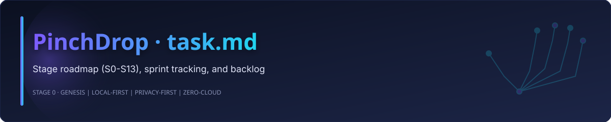
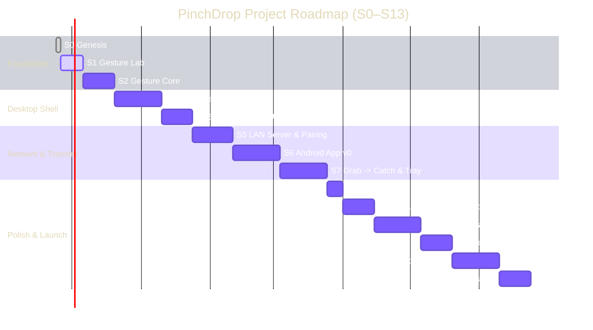

# task.md · Master Task Board & Roadmap

| Attribute | Specification |
|---|---|
| **Status** | 🟢 Live Board |
| **Owner** | Lead AI Engineer &amp; Project Manager |
| **Last Updated** | 2026-11-24 |
| **Source of Truth For** | Roadmap tracking (S0–S13), sprint tasks, and backlog |

> [!NOTE]
> **v1 rebuild in progress — Phase P6 of 7.** P1–P6 code written; P2–P6 not compiled yet (the dev PC is still downloading the C++ build tools and Gradle). gesture-core unit tests run and pass. Founder checks P1.7 / P2.7 / P3.8 / P4.8 / P5.8 / P6.6 open. The S0–S13 table below records the earlier prototype stages; their UI and Rust code were mock-ups and are being replaced phase by phase.

---

## 🚀 v1 Build Phases (P1–P7) — PC → phone

Approved 2026-11-25 together with the full screen design (see [memory.md](memory.md) → Design reference). Each phase ends with something the founder can run.

| Phase | Name | You test | Status |
|---|---|---|---|
| **P1** | **Desktop shell** — pill, Dynamic Island, main window screens, tray, start with Windows, settings | Run the `.exe` | 🟢 Built — founder check open |
| **P2** | **Android app shell** — every phone screen, permission flow, settings | Install the APK | 🟢 Written — build + founder check open |
| **P3** | **Real connection** — discovery, QR + 6-digit pairing, encrypted link, live phone name + battery | Pair your phone | 🟢 Written — build + founder check open |
| **P4** | **Manual send** — files, folders, text; Gallery / Downloads saving; receive animations; history; resume | Send real files | 🟢 Written — build + founder check open |
| **P5** | **Grab on PC** — Explorer/Desktop selection, webcam pinch, floating card, Island countdown | Pinch a folder | 🟢 Written — build + founder check open |
| **P6** | **Catch on phone** — incoming alert, camera open-hand detection, full gesture loop | The whole thing | 🟡 In progress |
| **P7** | **Polish & installers** — sounds, haptics, error states, Windows installer, release APK | Install fresh | ⚪ Pending |

### P1 · Desktop shell
- [x] `P1.1` Tauri 2 shell rebuilt: `main` + `pill` windows, single instance, tray menu (Open, Send, Show pill, Settings, Quit).
- [x] `P1.2` Persistent settings (`settings.json` in the app config folder) shared live between windows.
- [x] `P1.3` Pill: always on top, click → Island, double-click → app, drag anywhere with edge snapping + remembered position, right-click menu, sizes S/M/L, hide in full-screen apps, hide for 1 hour.
- [x] `P1.4` Dynamic Island: phone name, battery, network, Send files, gestures on/off, open app, auto-close.
- [x] `P1.5` Main window: first-run setup, Home (drop area + connected phone panel), Send (real file/folder picking and drag-drop with sizes), Transfers, Devices, Pair, Settings (every option), Profile.
- [x] `P1.6` Start with Windows, light/dark theme, reduced motion, demo-phone preview.
- [ ] `P1.7` Founder check on a real Windows desktop (multi-monitor, high-DPI).

### P2 · Android app shell
- [x] `P2.1` Gradle rebuilt: wrapper (Gradle 8.14.3), AGP 8.13, Kotlin 2.2, compileSdk/targetSdk 36, minSdk 26; prototype stubs removed (fake pairing, share target, QS tile, proximity "catch").
- [x] `P2.2` Settings stored on the phone (DataStore), changed in one transaction so quick taps never overwrite each other.
- [x] `P2.3` Onboarding: Welcome → Permissions (notifications, camera, nearby devices, stay connected in background — real Android pop-ups, "Settings" when blocked) → Pair (QR scanner placeholder, Phase 3) → Home.
- [x] `P2.4` Home (paired PC card or "No PC paired yet", ready-to-catch, recently received), Received (filters, empty state), Settings (every option from the design), Profile (phone name, model, reset).
- [x] `P2.5` Animation previews, clearly marked DEMO: incoming alert (real notification), Catch screen with countdown, Receiving ring, Photo arrived (drop → bounce + haptic → sharpen → check + chime). Honour the Arrival animation/sound/vibrate settings and Android's "remove animations".
- [x] `P2.6` Demo-PC preview toggle (Pair screen), light/dark/auto theme, JVM unit tests for shared helpers.
- [ ] `P2.7` Founder check on a real Android phone (install the debug APK).

### P3 · Real connection
Spec: [packages/protocol/LINK-v1.md](packages/protocol/LINK-v1.md).
- [x] `P3.1` PC: self-signed TLS identity (ECDSA P-256) created on first run; `wss://<pc>:47821/link` server (rustls + tokio-tungstenite); mDNS `_pinchdrop._tcp` advertisement with the fingerprint.
- [x] `P3.2` Pairing: QR (address, port, fingerprint, one-time token) or pick-from-Wi-Fi list; both screens show the same 6-digit code (SAS over fingerprint + both nonces); each side presses Pair; PC issues a device id + 32-byte secret. Shared test vector `749713` in both unit-test suites.
- [x] `P3.3` Reconnect: HMAC-SHA256 challenge proof; phone finds the PC by mDNS or last address, backs off 2 → 30 s; "unknown device" makes the phone forget the PC and say so.
- [x] `P3.4` Live status: phone sends name, model, battery %, charging, network type, free space on connect, on battery change and every 60 s; the pill, Island, Home and Devices show the real phone (offline = last seen).
- [x] `P3.5` Unpair from either side (tells the other side if connected); Reset unpairs everything.
- [x] `P3.6` Phone: CameraX + ZXing QR scanner (offline), "Found on this Wi-Fi" list, code screen, optional "Stay connected in background" foreground service (connectedDevice), restart after reboot.
- [ ] `P3.7` Compile both apps and run the unit tests (blocked on toolchain downloads).
- [ ] `P3.8` Founder check: pair the real phone, watch its battery on the pill, unplug Wi-Fi and come back.

### P4 · Manual send
Spec: [LINK-v1 §6](packages/protocol/LINK-v1.md).
- [x] `P4.1` PC: Send button works — files, folders (structure kept), notes and links; offer lists files by index only, so the phone can never ask for anything the user didn't pick; absolute paths only, `..` rejected, symlinks not followed.
- [x] `P4.2` Data: phone pulls 512 KB chunks, 4 in flight, as binary WebSocket frames; PC checks the file didn't change since the offer.
- [x] `P4.3` Phone saving: loose photos/videos → Gallery (Pictures/Movies/PinchDrop), the rest → Download/PinchDrop/…; written hidden (`IS_PENDING` / `.part`) until complete; "Replace" sends our own earlier copy to the phone trash (Android 11+), never a permanent delete; Android 8–9 keeps both.
- [x] `P4.4` Resume: both sides keep unfinished transfers on disk (`transfers.json` / `inbox.json`); the phone restarts from the bytes really on disk after a dropped link or restart.
- [x] `P4.5` Move mode: PC copy goes to the Recycle Bin (`trash` crate) only after the phone confirms every file.
- [x] `P4.6` Phone: Accept automatically or Ask first; real Receiving screen + progress notification; Arrived animation with the real photo; notes copied to the clipboard; Received list (filters, open, share, copy, remove from list) and Home "Recently received".
- [x] `P4.7` PC: Transfers screen with live progress, paused/declined/failed states, search, filters, cancel, clear history.
- [ ] `P4.8` Founder check: send a photo, a big video and a folder; turn Wi-Fi off halfway and back on; try Move.

### P5 · Grab on PC
Spec: [LINK-v1 §6.4](packages/protocol/LINK-v1.md).
- [x] `P5.1` Real Explorer / Desktop selection through the Shell COM interfaces (foreground window, active Windows 11 tab, Desktop via `FindWindowSW`); read-only, on its own COM thread. Replaces the old name-guessing prototype.
- [x] `P5.2` Camera only when the user asks (founder decision 2026-11-25): **clicking the pill** opens the Island and starts a camera session (default); Ctrl+Shift+Space does the same in hotkey mode; a new selection or a pinch keeps it alive; **30 s with nothing happening switches the camera off and folds the Island back into the pill**. Optional "while something is selected" mode. No always-on mode. While the session runs, clicking into Explorer doesn't close the Island. Camera permission granted to our own WebView2 windows only.
- [x] `P5.3` Click-through full-screen overlay window: MediaPipe HandLandmarker from bundled files (no CDN; verified zero external requests), One-Euro smoothing → `GrabMachine`. **Only two gestures act**: a deliberate pinch (hand steady 300 ms first, pinch held 150 ms, not a fist, not waving) grabs; a clearly open hand (≥3 fingers out, 200 ms) drops. Far/background hands and low-confidence readings are ignored; a half-open hand keeps holding; hand lost 1.5 s cancels. Frames go video → MediaPipe in memory only.
- [x] `P5.4` Hand ring, floating card (name, files, size) that follows the hand, card flies to the pill on release; "Camera on" chip whenever the camera runs; Island camera line with countdown and Stop / Turn on.
- [x] `P5.4b` Error handling, shown in plain words on the Island: camera blocked by Windows privacy, no camera, chosen camera unplugged, camera busy in another app, camera disconnected mid-session, hand tracking failed to load or keeps failing (all switch the camera off), nothing selected, item couldn't be held, hand left the camera, move closer.
- [x] `P5.5` Hold: Island countdown ring (Time to catch), *Send now* / *Drop it*; offered to the phone (`hold.offer`), caught sends auto-accepted on the phone.
- [x] `P5.6` Phone: real Catch screen for holds (countdown, Accept without gesture, Decline) + high-priority notification when the app is closed. Open-hand detection is P6.
- [x] `P5.7` Gesture unit tests: 15 for the grab rules (fist, far hand, unsure tracking, waving, entering mid-pinch, half-open hand, hysteresis, lost hand) — 25 gesture-core tests passing.
- [ ] `P5.8` Founder check: select CPP on the Desktop and in Explorer, pinch, move, open hand; watch the Island; catch on the phone with the button.

### P6 · Catch on phone
- [x] `P6.1` Front camera (CameraX) → MediaPipe HandLandmarker for Android with the same bundled model as the PC (uncompressed asset, works offline); GPU with CPU fallback; frames analysed in memory and dropped; runs only while the Catch screen is open.
- [x] `P6.2` `CatchDetector`: only a hand **close to the phone** that **opens** catches — closed/pinched then spread (150 ms), or a steady open palm (600 ms). Far hands, people walking past, fists, pointing, half-open hands, waving and unsure tracking are ignored. Easy / Normal / Strict from Settings → Hand detection. 10 JVM unit tests.
- [x] `P6.3` Catch screen: dimmed camera view, live hints (Watching · Bring your hand closer · Hand seen — now open it · Keep it open · Caught!), haptic + chime, then `hold.catch` → the PC sends → Receiving → Arrived.
- [x] `P6.4` Errors in plain words, with *Accept without gesture* always available: camera not allowed (Allow camera button), no front camera, camera busy in another app, hand tracking failed; catching by hand switched off.
- [x] `P6.5` Practice the catch (Settings) uses the real camera with a pretend folder; nothing is sent.
- [ ] `P6.6` Founder check: the whole loop — click the pill, select CPP, pinch, carry, open your hand over the phone; it arrives.

### v1.1 · Founder feedback after the first real test (2026-11-25)
Pairing, live battery and sending were confirmed working on a POCO F7 + HP laptop.
- [x] Recent on Home shows real sends; stale "Coming in Phase 5" badge removed.
- [x] Fresh white Apple-style look on both apps (graphite / true-black dark optional); existing installs switch once.
- [x] Pill + Island jet black with a hairline ring; the clipped rectangular shadow is gone.
- [x] Camera state only inside the Island (green indicator, countdown, Stop); no separate on-screen badge.
- [x] Setting: when the Island opens, start the camera or show **Start gestures**. **Ctrl+Shift+Space** opens/closes the Island.
- [x] Drag lag: one responsive pointer filter + motion prediction, detection once per camera frame, 640×360 up to 60 fps.
- [x] Full-screen lift-off animation when a send starts; "landed" burst for big sends.
- [x] Clipboard: pinch with nothing selected sends a copied link (opens on the phone), a short note, a long text as `.txt` (exact text), or formatted text as `.html`.
- [x] Island sized correctly while a send runs (no clipped pill shape); lift-off animation can no longer be hidden mid-play.
- [x] Phone opens the Catch camera by itself when the PC holds something ("Open Catch by itself" = Display over other apps; Xiaomi also needs "Open new windows while running in the background"); over the lock screen like a call.
- [x] Drag drawn at display rate (glide between camera frames + critically damped follow); the card is "carried" with a slight tilt.
- [x] Real previews on the floating card and Island: Explorer thumbnails in their own shape (photos, video frames, PDFs, Office), folder contents, first lines of text, link card, stacked multi-select.
- [x] Drag card is desktop-icon sized; the send animation shows the item itself (photo, folder, text…).
- [x] Send order: the lift-off plays alone, then the Island opens on the live progress and carries on from there.
- [x] Phone: receive bottom sheet with live progress, then a green tick; it brings PinchDrop up when "Open PinchDrop by itself" is allowed.
- [x] App sidebar fits short windows and collapses to icons when narrow; the profile is always visible.
- [ ] Founder check of v1.1 on the real laptop + phone (feel of the drag, colours, Island).

## 🚀 v2 backlog (agreed 2026-11-25, not started)
Full plan with how each feature works and the v2 gesture set: [docs/v2-plan.md](docs/v2-plan.md).

v2.1 (2026-11-26) — built, founder check open:
- Several phones on the pill: "+N ⌄" switcher; the shown phone drives the badge, Messages, Contacts. A call on any phone shows with the phone's name.
- WhatsApp / Instagram / Messenger calls: Answer / Reject / Silence (presses the app's own buttons); missed calls (SIM and apps) as a red icon per phone.
- Sounds on the PC for chat messages, texts and calls; chosen per phone in Settings → Your phone.
- OTP auto-copy, battery low / full notes, Now Playing with ✋ / 👉, recent photos strip (click to bring over), open the browser tab you're looking at on the phone (pinch), Explorer Send to → PinchDrop · <phone>, Scan to PC (phone), Copy to PC tile (phone), Find my phones map (live + last seen).
- Not yet: pinching a photo out of the strip (click works), Instagram/Messenger call buttons depend on each app's notification.

Also built in v2.0: the new gestures (palm hold, swipe, ✌️ reply, 👍 take it, fist, wave closes the Island, throw / point at a device chip, two-hand screenshot frame), clipboard both ways (Settings → Your phone, off by default) and find my phone.

| # | Feature | Notes |
|---|---|---|
| 1 | Phone → PC with gestures — 🟢 **built (v2.0), founder check open** | Share → PinchDrop → pinch at the phone → open hand at the laptop webcam (or Take it) → saved in Downloads\PinchDrop and opened; links open in the browser, notes go to the clipboard. LINK-v1 §6.5. Not yet: drop onto a pointed-at Explorer folder |
| 2 | Phone notifications on the PC — 🟢 **built (v2.0), founder check open** | Island banner with Reply / Dismiss; Notifications screen. Needs “Notification access” on the phone (Permissions screen). In memory only |
| 3 | SMS read + reply from the PC — 🟢 **built (v2.0), founder check open** | Messages screen: conversations, bubbles, reply with Enter, new message. SMS only (not MMS/RCS chats). Works for the direct APK; Play Store would restrict it |
| 4 | Contacts on the PC — 🟢 **built (v2.0), founder check open** | Contacts screen: search, Text (opens Messages), Call (the phone dials; or a tap-to-call notification if Android blocks it) |
| 5 | Calls — 🟢 **built (v2.0), founder check open** | Pill shows a vibrating 📞 with the caller's name; Island call card with Answer / Reject / Silence; while it rings the webcam takes open palm = answer, swipe = reject, fist = silence (Settings → Your phone). Call audio stays on the phone |
| 6 | Fast mode for big files — 🟢 **built (v2.0)** | 2 MiB chunks, 6 in flight when both sides support it (LINK-v1 §6.7). Not done: Wi-Fi Direct |
| 7 | Proximity-sensor catch — 🟢 **built (v2.0)** | Hover a hand over the top of the phone while something is in the air; works with the screen off (phone Settings toggle) |
| 8 | Several phones / tablets — 🟢 **built (v2.0)** | Holds offered to all; first to catch wins. While carrying, device chips appear: point and hold, drop on, or throw at one. Send screen picks a device |
| 9 | Laptop ↔ laptop — 🟢 **built (v2.0), not yet tested with two PCs** | Devices → Pair with another PC (on the other PC: Pair a new phone). One pairing works both ways: pinch on either PC, open your hand at the other one's camera (or drop on its chip). Files land in Downloads\PinchDrop with folders kept. LINK-v1 §6.8 |
| 10 | Pill: unread-message badge + ringing-call icon — 🟢 **built (v2.0)** | 💬 count beside the battery (click → Messages); 📞 shakes with the caller's name; missed call shows a red icon until clicked |

## 🗺️ Prototype Roadmap (S0–S13, superseded by P1–P7)

*Estimates based on solo part-time development (15–20 hours/week):*

| Stage | Name | Target Outcome | Estimate | Status |
|---|---|---|---|---|
| **S0** | **Genesis** | Skeleton, documentation, asset pipeline, PDF overview | 1–2 days | 🟢 Done |
| **S1** | **Gesture Lab** | Standalone webcam page + One-Euro filter + HUD + Replay | 1–2 wks | 🟢 Done |
| **S2** | **Gesture Core** | Pure TS deterministic FSM + replay test harness + metrics | 2 wks | 🟢 Done |
| **S3** | **Air Workspace UI** | Tauri 2 shell + oversized cards + zones + pointer ring | 3 wks | 🟢 Done |
| **S4** | **File Ops & Safety** | Rust allow-list, trash crate integration, undo journal | 2 wks | 🟢 Done |
| **S5** | **LAN Transfer Engine** | Axum HTTP/WS server, TLS 1.3, pairing, 5GB soak test | 2–3 wks | 🟢 Done |
| **S6** | **Android App v0** | Compose app, QR pairing, MediaStore download | 3 wks | 🟢 Done |
| **S7** | **Grab → Catch & Stage Tray** | Share target, tiles, in-app capture, Peek, ARMED state | 3 wks | 🟢 Done |
| **S8** | **Air Clipboard** | Bi-directional clipboard, Open on device, Throw gesture | 1 wk | 🟢 Done |
| **S9** | **Gesture Gym & Settings** | First-run onboarding, calibration, privacy controls | 2 wks | 🟢 Done |
| **S10** | **Polish Pass** | 60 fps spring animations, audio cues, a11y, latency audit | 3 wks | 🟢 Done |
| **S11** | **Beta Packaging** | Signed Windows MSI/NSIS installer, updater, Play AAB | 2 wks | 🟢 Done |
| **S12** | **Pro & Monetization** | Local licensing engine, Pro feature unlock (lasso/smart) | 3 wks | 🟢 Done |
| **S13** | **Public Launch** | Store listings, demo recordings, public release v1.0 | 2 wks | ⚪ Pending |

---

## 📋 Granular Task Board: S0–S3

### Stage 0: Genesis (🟢 Done)
- [x] `T-0.1` Monorepo skeleton (`pnpm-workspace.yaml`, `.editorconfig`, `.gitignore`, `.gitattributes`, `LICENSE`).
- [x] `T-0.2` Offline SVG asset generator (`tools/make-assets.mjs`).
- [x] `T-0.3` Offline Mermaid diagram renderer (`tools/render-diagrams.mjs`).
- [x] `T-0.4` Offline executive PDF compiler (`tools/build-pdf.mjs`).
- [x] `T-0.5` Documentation suite (`README.md`, `AGENTS.md`, `memory.md`, `product.md`, `architecture.md`, `rules.md`, `design.md`).
- [x] `T-0.6` Detailed technical specs (`docs/gestures.md`, `docs/protocol.md`, `docs/security-privacy.md`, `docs/monetization.md`).
- [x] `T-0.7` Canonical ADRs (`docs/adr/0001` through `0007`).
- [x] `T-0.8` Internal markdown reference validator (`tools/check-links.mjs`).
- [x] `T-0.9` Initial `@pinchdrop/gesture-core` package with passing smoke test.
- [x] `T-0.10` External services & developer credentials documentation (`docs/services.md`).
- [x] `T-0.11` Stage 0 fixes and verification report (`docs/reports/stage-0-fixes.md`).

### Stage 1: Gesture Lab (🟢 Done)
- [x] `T-1.1` Scaffold standalone Vite + React page in `tools/gesture-lab`.
- [x] `T-1.2` Vendor MediaPipe Tasks-Vision WASM and hand landmarker model locally (zero CDN).
- [x] `T-1.3` Implement One-Euro adaptive filter on fingertip coordinates and 21 landmarks.
- [x] `T-1.4` Implement visual HUD showing FPS, latency, jitter, and pinch ratio.
- [x] `T-1.5` Implement session recording to JSON and replay fixture exporter.
- [x] `T-1.6` Measure latency and jitter benchmarks across Chrome and WebView2.

### Stage 2: Gesture Core (🟢 Done)
- [x] `T-2.1` Implement pure TS One-Euro filter in `@pinchdrop/gesture-core`.
- [x] `T-2.2` Implement scale-invariant pinch and pose classifiers (`G1`–`G6`).
- [x] `T-2.3` Implement deterministic gesture FSM including `ARMED`, `ARM_DELETE`, and `RENAME_ARMED`.
- [x] `T-2.4` Create automated replay test harness with landmark session fixtures.
- [x] `T-2.5` Verify false-trigger rate metrics (0 false triggers measured in 300-frame resting/typing fixtures).

### Stage 3: Air Workspace UI (🟢 Done)
- [x] `T-3.1` Scaffold Tauri 2 desktop application structure in `apps/desktop` and `apps/desktop/src-tauri`.
- [x] `T-3.2` Implement aurora glass workspace grid with 96+ px interactive file cards.
- [x] `T-3.3` Implement 4 screen edge zones (Phone Zone, Inbox Zone, Rename Zone, Trash Zone).
- [x] `T-3.4` Implement dynamic Pointer Ring with hold-fill animation and interactive card snapping.
- [x] `T-3.5` Implement 8-second visual Undo Toast with radial countdown ring and Recycle Bin restore.
- [x] `T-3.6` Wire mouse fallback alongside `@pinchdrop/gesture-core` state machine and simulate Phone Grab (ARMED).

### Stage 9: Gesture Gym & Privacy Dashboard (🟢 Done)
- [x] `T-9.1` Implement interactive Gesture Gym with real-time feedback, pinch gauge calibration, and achievement tiers.
- [x] `T-9.2` Implement Zero-Storage Privacy Dashboard with cryptographic local-only proof and hardware camera kill switch.
- [x] `T-9.3` Integrate Gesture Gym and Privacy Dashboard modal controls into desktop header bar.

### Stage 10: Polish Pass & Audio/Haptics (🟢 Done)
- [x] `T-10.1` Implement zero-dependency Web Audio procedural sound engine (`apps/desktop/src/utils/audio.ts`).
- [x] `T-10.2` Implement `useMotionPreference` hook with OS `prefers-reduced-motion` detection and user override.
- [x] `T-10.3` Tune 60fps spring transitions (`stiffness: 380, damping: 26`) and instant accessible mode across `FileCard` and `PointerRing`.
- [x] `T-10.4` Integrate sound cues (pop, click, whoosh, thud, chime) and audio/motion controls into desktop workspace header.
- [x] `T-10.5` Implement automated microsecond-precision latency and jitter benchmark tool (`tools/benchmark-latency.mjs`).

### Stage 11: Beta Packaging & Installers (🟢 Done)
- [x] `T-11.1` Configure Tauri 2 Windows NSIS and WiX/MSI bundle targets with multi-resolution icon assets (`tauri.conf.json`, `tools/generate-icons.mjs`).
- [x] `T-11.2` Configure Tauri auto-updater plugin with Minisign Ed25519 public key and GitHub Releases endpoint.
- [x] `T-11.3` Configure Android companion release signing config and R8/ProGuard shrinking rules (`proguard-rules.pro`, `build.gradle.kts`).
- [x] `T-11.4` Create automated GitHub Actions multi-platform release packaging workflow (`.github/workflows/release.yml`).
- [x] `T-11.5` Implement 22-check packaging and installer audit verification tool (`tools/package-verify.mjs`).

### Stage 12: Pro & Monetization Engine (🟢 Done)
- [x] `T-12.1` Implement local offline cryptographic licensing engine in Rust (`license.rs`, `AppState`).
- [x] `T-12.2` Expose licensing IPC commands (`get_license_info`, `activate_license_key`, `deactivate_license`).
- [x] `T-12.3` Implement React `useLicense` hook with offline feature gating and dev fallback.
- [x] `T-12.4` Implement `ProModal` aurora glass upgrade showcase with offline demo key activation.
- [x] `T-12.5` Add unit test suite for license activation, tier detection, and persistence (`tests/license_engine.rs`).

---

## 📈 Roadmap Gantt Chart

---

[← Prev: rules.md](rules.md) · [Index](README.md) · [Next: design.md →](design.md)
