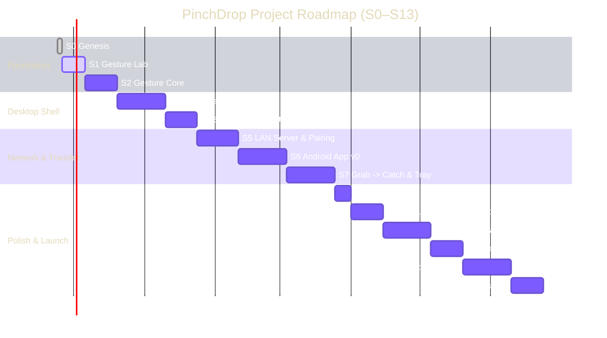

# task.md · Master Task Board & Roadmap

| Attribute | Specification |
|---|---|
| **Status** | 🟢 Live Board |
| **Owner** | Lead AI Engineer &amp; Project Manager |
| **Last Updated** | 2026-11-24 |
| **Source of Truth For** | Roadmap tracking (S0–S13), sprint tasks, and backlog |

> [!NOTE]
> Overall Project Progress: `▰▰▱▱▱▱▱▱▱▱ 15%` (Stage 0 Complete)

---

## 🗺️ Canonical Roadmap (S0–S13)

*Estimates based on solo part-time development (15–20 hours/week):*

| Stage | Name | Target Outcome | Estimate | Status |
|---|---|---|---|---|
| **S0** | **Genesis** | Skeleton, documentation, asset pipeline, PDF overview | 1–2 days | 🟢 Done |
| **S1** | **Gesture Lab** | Standalone webcam page + One-Euro filter + HUD + Replay | 1–2 wks | 🟢 Done |
| **S2** | **Gesture Core** | Pure TS deterministic FSM + replay test harness + metrics | 2 wks | ⚪ Pending |
| **S3** | **Air Workspace UI** | Tauri 2 shell + oversized cards + zones + pointer ring | 3 wks | ⚪ Pending |
| **S4** | **File Ops & Safety** | Rust allow-list, trash crate integration, undo journal | 2 wks | ⚪ Pending |
| **S5** | **LAN Transfer Engine** | Axum HTTP/WS server, TLS 1.3, pairing, 5GB soak test | 2–3 wks | ⚪ Pending |
| **S6** | **Android App v0** | Compose app, QR pairing, MediaStore download | 3 wks | ⚪ Pending |
| **S7** | **Grab → Catch & Stage Tray** | Share target, tiles, in-app capture, Peek, ARMED state | 3 wks | ⚪ Pending |
| **S8** | **Air Clipboard** | Bi-directional clipboard, Open on device, Throw gesture | 1 wk | ⚪ Pending |
| **S9** | **Gesture Gym & Settings** | First-run onboarding, calibration, privacy controls | 2 wks | ⚪ Pending |
| **S10** | **Polish Pass** | 60 fps spring animations, audio cues, a11y, latency audit | 3 wks | ⚪ Pending |
| **S11** | **Beta Packaging** | Signed Windows MSI/NSIS installer, updater, Play AAB | 2 wks | ⚪ Pending |
| **S12** | **Pro & Monetization** | Local licensing engine, Pro feature unlock (lasso/smart) | 3 wks | ⚪ Pending |
| **S13** | **Public Launch** | Store listings, demo recordings, public release v1.0 | 2 wks | ⚪ Pending |

---

## 📋 Granular Task Board: S0–S3

### Stage 0: Genesis (🟢 Done)
- [x] `T-0.1` Monorepo skeleton (`pnpm-workspace.yaml`, `.editorconfig`, `.gitignore`, `.gitattributes`, `LICENSE`).
- [x] `T-0.2` Offline SVG asset generator (`tools/make-assets.mjs`).
- [x] `T-0.3` Offline Mermaid diagram renderer (`tools/render-diagrams.mjs`).
- [x] `T-0.4` Offline executive PDF compiler (`tools/build-pdf.mjs`).
- [x] `T-0.5` Documentation suite (`README.md`, `AGENTS.md`, `memory.md`, `product.md`, `architecture.md`, `rules.md`, `design.md`).
- [x] `T-0.6` Detailed technical specs (`docs/gestures.md`, `docs/protocol.md`, `docs/security-privacy.md`, `docs/monetization.md`).
- [x] `T-0.7` Canonical ADRs (`docs/adr/0001` through `0007`).
- [x] `T-0.8` Internal markdown reference validator (`tools/check-links.mjs`).
- [x] `T-0.9` Initial `@pinchdrop/gesture-core` package with passing smoke test.
- [x] `T-0.10` External services & developer credentials documentation (`docs/services.md`).
- [x] `T-0.11` Stage 0 fixes and verification report (`docs/reports/stage-0-fixes.md`).

### Stage 1: Gesture Lab (🟢 Done)
- [x] `T-1.1` Scaffold standalone Vite + React page in `tools/gesture-lab`.
- [x] `T-1.2` Vendor MediaPipe Tasks-Vision WASM and hand landmarker model locally (zero CDN).
- [x] `T-1.3` Implement One-Euro adaptive filter on fingertip coordinates and 21 landmarks.
- [x] `T-1.4` Implement visual HUD showing FPS, latency, jitter, and pinch ratio.
- [x] `T-1.5` Implement session recording to JSON and replay fixture exporter.
- [x] `T-1.6` Measure latency and jitter benchmarks across Chrome and WebView2.

### Stage 2: Gesture Core (⚪ Pending)
- [ ] `T-2.1` Implement pure TS One-Euro filter in `@pinchdrop/gesture-core`.
- [ ] `T-2.2` Implement scale-invariant pinch and pose classifiers.
- [ ] `T-2.3` Implement XState gesture FSM including ARMED state.
- [ ] `T-2.4` Create automated replay test suite with landmark fixtures.
- [ ] `T-2.5` Verify false-trigger rate metrics (< 1/hr target).

### Stage 3: Air Workspace UI (⚪ Pending)
- [ ] `T-3.1` Scaffold Tauri 2 desktop application in `apps/desktop`.
- [ ] `T-3.2` Implement aurora glass workspace grid with 96+ px file cards.
- [ ] `T-3.3` Implement screen edge zones (Phone, Inbox, Rename, Trash).
- [ ] `T-3.4` Implement Pointer Ring with hold-fill animation and ghost hand overlay.
- [ ] `T-3.5` Wire mouse-driven simulation before connecting camera feed.

---

## 📈 Roadmap Gantt Chart

---

[← Prev: rules.md](rules.md) · [Index](README.md) · [Next: design.md →](design.md)
